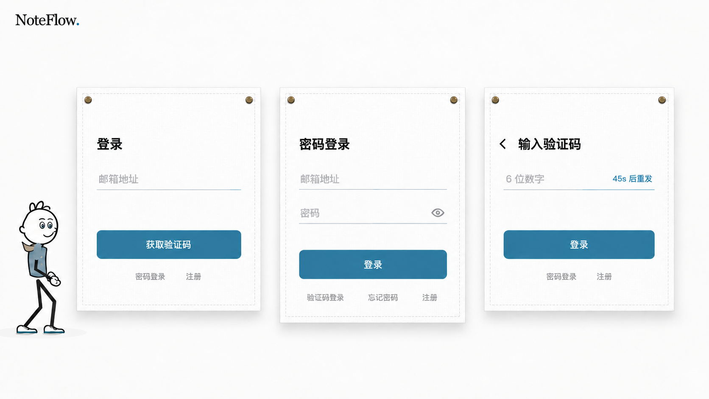

# 登录卡片整套方案：邮箱 / 密码 / 验证码

日期：2026-10-25。用户指出上一轮只细化了验证码，最初登录页仍有输入外框，且没有解释卡片本身的设计。
本轮纠正为“共用卡片系统 + 多状态评审”，不是继续把一个输入框当作全部登录设计。



这张图并排展示三种独立状态，不表示正式页面会同时出现三张卡片。使用内置 imagegen，
以前一版布面 / 小人为风格参考；新图和完整提示词归档，旧图不覆盖。

## 卡片本身的设计理由

- 外层：只保留一张浅白布面，细缝线和两个固定扣形成产品辨识度，低对比纹理与一层柔影区分表面。
  不在内部再叠白板 / 卡片 / 胶囊。小人继续保留，不增加玩具式说明或控制。
- 网格：共用标题、输入区、主按钮、次级入口的顺序，以及左右内边距、控件宽度与留白节奏。
  邮箱和验证码都是单输入状态，优先保持同尺寸、同主操作位置；密码页按多一个输入项适度增加高度。
  不继续为不存在的密码字段预留大块空白。位图只能评审趋势，最终高度和间距不是模型保证的像素参数。
- 输入：邮箱、旧 / 新密码、验证码都拟用透明原生表面与单条细底线，无四边包围、无额外输入底色。
  底线保留可输入提示；聚焦 / 失效状态通过颜色反馈，不能靠不透明内阴影遮盖浏览器光标 / 选区。
- 字体：标题目标约 20–22px、字段约 16px、按钮字约 14px、次级入口约 12px；降低展示型字重。
  这些是后续实现的比例意图，不是从生成图测得的字号，也不以小字替代足够的命中区域。
- 动作：一张卡片只有一个明显实色主操作；所有方法切换、注册、找回入口都在缝线以内，用安静文字区分主次。
  不新增宣传、套餐、步骤编号、安全徽章或社交登录。

## 三个核心状态

| 状态 | 所需输入 | 主动作 | 卡片内次级入口 |
| --- | --- | --- | --- |
| 邮箱登录 | 邮箱地址 | 获取验证码 | 密码登录、注册 |
| 密码登录 | 邮箱地址、密码（原有眼睛图标） | 登录 | 验证码登录、忘记密码、注册 |
| 输入验证码 | 单个六位数字输入、同排重发倒计时；不再显示邮箱 | 登录 | 返回邮箱图标、密码登录、注册 |

注册与重设密码应复用这套组件规则，包括新密码；本图没有完整绘制它们的所有步骤、加载或错误状态，
不能把“三态图”称作全量认证设计已验收。拟将必要错误集中在主操作附近，成功通知不占解释段落；
内部邮箱 / 目的状态、取消 / 迟到保护、冷却和自动填充原生编辑修复都必须保留。

## 验证与本轮范围

初稿的密码卡片高度及标题网格未符合提示，已定向再生成，核对标题 / 首输入对齐方向、密码页更高、
验证码返回箭头归入标题行，以及三个页面均为无四边框输入、次级入口位于卡片内。
人工检查最终中文和入口完整，密码页保留眼睛及注册，没有真实邮箱 / 凭据；PNG 为 1672×941。
生成图不能保证精确行距 / 高度，后续必须用真实组件渲染复核；不据此直接改变布料网格或动画。

本轮只增加图片 / 说明，更新 V2 范围澄清和 AUTH-10 / UI-05 / UI-17 原问题记录。
未修改 src、认证接口、原生输入、物理 / 入场或测试，未发邮件或登录；没有重新运行产品构建。
仅图片人工检查、文件 / 本地引用、Git 差异及 diff --check；用户评审、手机 / 深色 / 错误 / 加载、
键盘 / 读屏、各认证分支和动画的真实运行验收仍未完成。正式页面没有应用本图。

## 生成方式与完整提示词

工具：内置 imagegen，无 CLI / API Key 回退。
风格输入：`design/noteflow-auth-code-only-preview-v2.png`。
最终归档：`design/noteflow-auth-card-system-preview.png`；中间生成文件留在默认生成目录，没有引用为项目资源。

### 初始三态设计提示

```text
Use case: ui-mockup. Asset type: one high-fidelity authentication CARD SYSTEM design board for NoteFlow, showing three coordinated component states. This is a static review board, NOT a screenshot of three login cards appearing together in the actual app.
Image 1 is a STYLE AND CHARACTER reference, not a literal edit target. Keep the exact warm-white and muted slate-blue direction, extremely faint white cloth weave, single fine stitched outer edge, two small brass top fasteners per card, and one very soft shadow. Preserve the same friendly thin black-line character in blue-gray sweater and tiny beige scarf; show this character ONCE, small at the lower left of the overall board, not repeated per card. Wordmark 'NoteFlow.' once at upper left.
Composition: wide landscape review board approximately 16:9. Three equal-width cloth cards in one horizontal row, with generous clear gutters, top edges aligned and interiors drawn at the SAME scale. Show them prominently, readable, not tiny in vast whitespace. All three use the same header/inset grid, control widths, slate-blue primary action, quiet internal secondary-action row and small system-sans typography. Left and right cards are identical compact heights; middle password card extends downward by exactly one extra input row plus its spacing, never a huge empty area. No additional board title or captions: the real card headings identify each state.
Card 1, email-first login: small 20–22 logical px medium-weight heading '登录'. One unboxed input row with placeholder '邮箱地址'. A thin pale-gray horizontal baseline under the row; NO enclosing rectangle or tinted field background. A full-width muted slate-blue primary button labeled '获取验证码' in 14 logical px medium-weight white text. Below the button INSIDE the stitched boundary, one low-emphasis footer row '密码登录' and '注册'.
Card 2, password login: small heading '密码登录'. Two unboxed rows, '邮箱地址' and '密码', each with just one thin pale-gray baseline and no surrounding border or fill. A small eye-outline icon at the right of the password row (no text label). Same primary button labeled '登录'. Inside its footer preserve ALL THREE existing actions, in quiet small text: '验证码登录', '忘记密码', '注册'. Do not omit registration. Give the extra row its needed height rather than compressing the controls or leaving the one-field cards tall.
Card 3, verification step: one small left chevron in the header row beside a small heading '输入验证码', not a separate tall toolbar. One unboxed input row with '6 位数字' left and '45s 后重发' right, and ONE uniform very thin horizontal baseline below both. Same primary button labeled '登录'. Footer inside the cloth: '密码登录', '注册'. No email address, recipient confirmation, masked email, change-email word or pencil in this step.
Card proportions and rhythm: about 326 logical px wide, calm 28px horizontal inset, headings around 20–22px (not heavy display type), inputs around 16px, primary button labels 14px, secondary actions 12px. Input row has 44–48px usable height. About 24px between controls/primary action; footer 16–24px below button. Carefully balance top/bottom padding. Left and right input/button/footer align at exactly the same vertical positions. NO unused password slot in one-field cards. Footer links are always on the cloth, never underneath/outside. No fake input fills, no floating cards inside cards, no strong outer frame, no thick focus ring, no six PIN boxes, no vertical dividers.
Allowed Chinese text must be crisp, correctly written and in exactly the indicated cards. Do not add '验证码已发送', emails, '@', '更换', marketing, descriptions, replay/reset buttons, social sign-in, checkboxes, safety shields, step numbers, annotations, arrows connecting panels or watermark. Keep this a coherent understated login-card design, not a toy or conceptual poster. The cloth card itself is the single outer container; all fields including initial email AND password must be borderless except their baselines.
```

### 定向对齐提示

```text
Edit this authentication design board with a SINGLE targeted layout correction. Preserve every other aspect: same three cards left-to-right, same exact Chinese text and actions, same one character, same cloth/pins/stitch/shadows, palette, scale, canvas and wordmark. Keep all fields unboxed with ONLY a single thin uniform pale-gray baseline. No surrounding input rectangles.
The first draft missed the shared header grid and content-driven middle-card height. Correct those, without redesigning the board:
- Leave the left email card and right code card exterior positions, widths and compact heights unchanged.
- Align ALL THREE main headings on the same horizontal baseline, and align the FIRST input row/baseline of all three cards horizontally. Their common top padding and left/right internal insets should match.
- In the right card, MOVE its small back chevron down into the SAME HEADER ROW as '输入验证码', just to the left of that heading, rather than floating above it. Keep enough space for the title; no separate back-toolbar row.
- The middle password card must be visibly TALLER than the side cards by exactly ONE extra input-row rhythm, extending DOWNWARD only while keeping its top edge aligned. Increase its bottom boundary downward by about 80 pixels at this image scale, including extending the faint cloth weave, stitched side edges and soft shadow. Do not make the one-field cards taller.
- In the middle card, the first '邮箱地址' row aligns with the side cards' first row. Keep its second '密码' row plus the eye icon one row below. Place its '登录' button and all THREE footer actions '验证码登录', '忘记密码', '注册' one input-row lower than the side cards' buttons and footers. Keep padding below the footer comparable to the side cards.
- Left/right button tops and left/right footer baselines must remain aligned with each other. Middle button/footer naturally sit lower because of the added password row. All secondary actions remain INSIDE their card's stitched boundary.
Keep exact headings: left '登录'; middle '密码登录'; right '输入验证码'. Left action '获取验证码'. All other labels unchanged. No email VALUES or '@', no extra copy or captions. This remains a three-state component review image, not a real multi-card page. Text crisp and correctly spelled; do not enlarge fonts.
```

