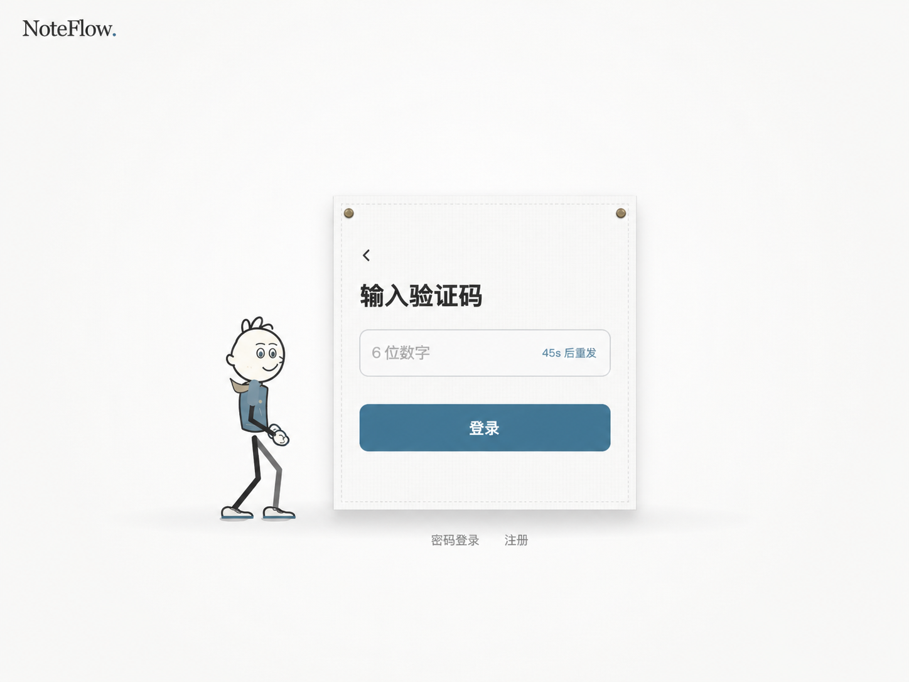

# 验证码专注态静态预览

日期：2026-10-25。用户要求先看设计图，明确不希望进入验证码步骤后继续显示邮箱。



## 本轮边界

本图由内置 imagegen 生成，是待评审的静态设计候选，不是正式页面截图或已实施功能。
只增加本图、说明及 AUTH-10 的反馈记录；src、认证接口、布局 / 物理脚本与测试均未修改。

- 验证码步骤去掉完整 / 简略邮箱、“更换”和铅笔，标题直接说明“输入验证码”。
- 一个验证码输入框，重发倒计时在框内右侧；主按钮与输入框就近组成同一内容组，减少原密码槽带来的大块空白。
- 仅以左上返回图标回到邮箱步骤，保留原“密码登录 / 注册”次级入口，不增加说明段落或演示控件。
- 暖白 / 灰蓝、浅白布面、缝线、固定扣和原小人形象延续现有方向。
- 卡片比例更紧凑，图中的尺寸、字形和间距是视觉示意，不作为像素级实现参数。

## 验证与限制

已人工检查生成图：标题和控件中文可读，未显示邮箱 / @ / 更换 / 铅笔 / 错误段落；
图中主次关系、返回箭头、单字段与框内倒计时完整，PNG 为 1448×1086。
仅做图片与文档检查、Git 差异 / 空白检查；没有重新运行产品构建、发送验证码或登录。

后续评审：用户认可本稿整体及卡片，进一步要求将密码登录 / 注册移入卡片、缩小标题 / 按钮字、去掉输入四边框。
对应的[三处细化 V2](noteflow-auth-code-only-preview-v2-notes.md)另存新稿，本图和原提示词作为历史保留；不是实施授权。

正式页面仍是 7768f8e 的布局，未根据本图改变交互。本次细化尚待确认；浅深色、错误 / 加载、
手机、键盘 / 读屏和动画状态尚未设计或运行验收。若后续实施，邮箱仍需在内部保留用于提交认证，
不显示邮箱不等于删除身份状态；返回、用途冷却、取消 / 迟到请求及原生输入修复仍须保留并复验。
不能把更紧凑的静态比例当作已经验证了布料网格 / 入场布局。

## 生成方式和完整提示词

工具：内置 imagegen，未使用 CLI / API Key 回退。
输入图：上一轮正式组件的合成网关错误截图，仅作布面 / 小人 / 配色参考，不包含真实邮箱或凭据。
输出归档：`design/noteflow-auth-code-only-preview.png`。原始生成文件保留，未覆盖历史预览。

```text
Use case: ui-mockup. Asset type: a single high-fidelity static preview of NoteFlow's email-verification login step, NOT a comparison board and NOT an implementation screenshot.
Input image 1 is a STYLE AND CHARACTER reference only: keep the same fine black-line friendly little person, blue-gray sweater, beige tiny scarf, slim dark limbs; warm white page, very subtle white cloth weave, fine stitched cloth edge, two small brass fasteners, soft shadow and slate-blue action color. Keep the same NoteFlow. wordmark at upper left. Do not add any new decorative objects or marketing.
Primary redesign: after entering the email, the card must focus ONLY on entering the code. Remove every email address, masked email, '@', recipient row, pencil icon, '更换', explanatory paragraph and error message. The verification step must NOT repeat the email identity.
Composition: one polished, front-facing desktop page, landscape approximately 4:3. Frame the main person-and-card composition prominently at comfortable viewing scale, centered in the page with sensible surrounding whitespace; full person visible standing just to the left of the cloth card, feet near its lower edge. Unlike the tall empty reference, the verification cloth card is a more compact, balanced portrait rectangle approximately 326 wide by 360 high in logical UI proportions. Preserve the cloth material/fasteners/character identity, not the old tall blank interior.
Card layout: a small quiet left-chevron return icon at the upper-left inside the card, no accompanying text; below it a clear left-aligned 28px semibold Chinese heading '输入验证码'. Then a SINGLE wide rounded native-looking code field with thin pale gray boundary and the placeholder '6 位数字', and a small right-aligned countdown '45s 后重发' INSIDE that same field. No six separate boxes. Leave about 24px between the field and a full-width slate-blue rounded primary button labeled '登录'. Treat heading, field and button as one visually balanced content group: no huge unused password slot and no enormous vertical gap. Generous but deliberate top/bottom padding. Below the cloth card keep only a single quiet line of two existing alternative actions '密码登录' and '注册'. Do not add steps, illustrations, safety icons, badges or panels.
Text must be crisp and exact Simplified Chinese, using the same clean system sans-serif UI type. The only visible text permitted in the entire picture is 'NoteFlow.', '输入验证码', '6 位数字', '45s 后重发', '登录', '密码登录', '注册'. The back icon is just a single chevron, not a close X. No emails, no '验证码已发送', no '更换', no 'Bad Gateway', no annotations, no arrows explaining the design, no watermark. This is a calm, practical login interface, not a toy, poster, dashboard or photography.
```

