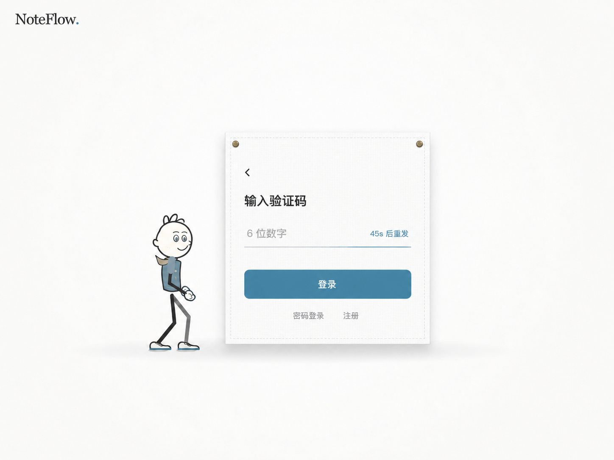

# 验证码专注态 V2：入口归卡片、轻字与无外框输入

日期：2026-10-25。用户认可[首稿](noteflow-auth-code-only-preview-notes.md)的整体方案和卡片，进一步提出三项细化：
密码登录 / 注册放进卡片，标题及按钮文字缩小，验证码输入不再包一圈框。



## 本轮设计变化

1. 两个次级入口在主按钮下方、卡片缝线内部居中成一行；卡片外不再散放入口。
2. 标题及按钮字更小、更轻，标题提示约 20–22px、按钮字约 14px 的逻辑比例；不把生成图当作精确字号测量。
3. 原生单验证码输入拟采用透明表面 + 单条细底线，取消四边框 / 圆角包围 / 额外底色；
   占位文字与倒计时同排，保持清晰可输入的提示。实色主按钮继续承担主要动作。

保留上一稿的紧凑布面、两个固定扣、缝线、原小人、暖白 / 灰蓝、返回图标，以及不再显示邮箱的原则。
这三个变化没有必须把次级入口留在卡片外或保留矩形输入边框的技术前提。

## 验证和未实施边界

内置 imagegen 使用首稿作为编辑目标，非破坏性输出新文件。已人工检查：中文可读且无新增说明，
次级入口在缝线内，标题 / 按钮字相对首稿缩小，输入无四边包围；人物与卡片外部方向保持。
PNG 为 1448×1086；文件、文档链接和 Git 空白检查通过。

本轮仅设计图片 / 文档；没有修改 src、动画 / 物理、原生输入、认证接口或测试，没有发送验证码或登录。
没有重新运行构建或将静态图的可读性当作键盘 / 读屏 / 对比度 / 手机 / 深色 / 动画的运行验收。
用户已认可的是首稿方向，本次三处细化仍待实际评审。若获准实施，需要继续保留透明原生输入、
可见光标 / 选区、自动填充同值交接、至少 44px 命中和原请求取消 / 冷却规则，不能恢复遮挡输入的内阴影。
底线聚焦 / 报错的确切颜色、尺寸和各认证步骤布局需在真实组件中校验，不从位图直接推断实现。

## 生成方式和完整提示词

工具：内置 imagegen，未用 CLI / API Key 回退。
编辑目标：`design/noteflow-auth-code-only-preview.png`，原图保留。
本版归档：`design/noteflow-auth-code-only-preview-v2.png`。

```text
Use case: ui-mockup. High-fidelity static UI preview edit, not a running product screenshot.
Image 1 is the edit target: refine this exact NoteFlow verification card with ONLY the following three changes.
1. MOVE the existing '密码登录' and '注册' links from outside/below the card to INSIDE the cloth card, as one understated centered footer row beneath the primary button, with comfortable 20–24 logical px spacing. Nothing should dangle below the card. Do not add a container, border, divider or icon around these links.
2. Make typography quieter: the heading '输入验证码' should be noticeably smaller than the reference, about 20–22 logical px and medium weight instead of large bold display text. The primary button label '登录' should be about 14 logical px, medium weight, not oversized or heavy. Secondary links about 12px, countdown about 11px. Preserve crisp, readable Simplified Chinese system-sans typography and clear hierarchy.
3. Completely REMOVE the rounded rectangular border around the code input. Do NOT replace it with another rectangle, tinted box, capsule, shadow, card or six boxed slots. Let the input blend directly into the white cloth surface. Indicate the input using one very thin pale-gray horizontal BASELINE ONLY, with a subtle muted blue emphasis as a focus cue, beneath the placeholder and countdown. '6 位数字' on the left and '45s 后重发' on the right share a single unboxed field row with generous usable click space. No vertical lines, top border or rounded outline. Keep the slate-blue filled primary login button as the one clear solid action, about 24 logical px below the input baseline.
Invariants: preserve the exact compact cloth card exterior, two brass pins, fine stitched edge, faint white weave, original soft shadow, page layout and framing. Preserve the same friendly thin-line character, face, hair, pose, blue-gray sweater, tiny beige scarf, slim dark limbs and its scale/position to the left of the card. Keep the warm-white backdrop, slate-blue palette, small upper-left 'NoteFlow.' wordmark and the quiet left-chevron back icon inside the card. Do not enlarge or lengthen the card to fill space. Preserve the improved compact grouping and balanced white space; do not create a huge empty password slot.
No email, masked email, '@', '更换', pencil, instructions, marketing, error paragraph, checkboxes, social login, progress labels, badges, arrows explaining the design, multiple panels, screenshot chrome, or watermark.
The ONLY visible text anywhere is exactly: 'NoteFlow.', '输入验证码', '6 位数字', '45s 后重发', '登录', '密码登录', '注册'. Render each exactly once. All controls including the two secondary links must be inside the stitched cloth boundary. Return one polished complete page image in the same approximately 4:3 landscape framing as the reference, with no design annotations.
```

