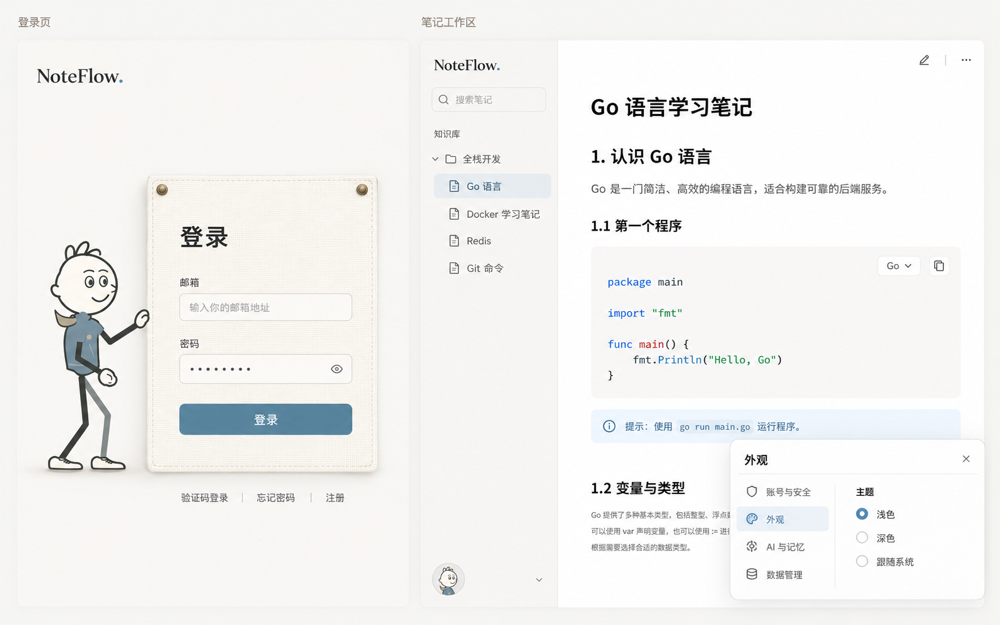

# NoteFlow 暖白 / 灰蓝统一视觉实施

日期：2026-10-24。用户先要求静态预览，后明确回复“看起来还不错，可以的，就弄这个吧”。

## 批准的方向与边界

概念图由 imagegen 生成，仅作颜色、材质和层次的评审依据，并非真实功能截图。
保留真实应用的邮箱优先登录、已有浅 / 深色选项、账号资料、目录与正文结构；
不添加图中的“跟随系统”等示例功能，不替换用户头像、笔记或账号数据，不增加顶栏 / 品牌占位。

目标是同一个产品的两种使用场景：登录入口保留小人和布料，工作区保持安静阅读。
不把工作区铺成布纹，不重做布局、阅读密度、标题编号、代码高亮或代码工具栏。

## 变化

- `ui-foundation.css` 增加共享背景、主操作、主操作文字、强调文字、导航选中层和输入选区颜色。
  浅色主操作为 `#3f7898`，深色为 `#427693`，均配白字；保留原中性悬停层与危险 / 成功语义。
- `index.css` 中原 Jelly 变量映射到共享颜色，目录选中层和图标使用同一灰蓝层次。
  修正末尾旧字体覆盖，UI 字体归到 `--nf-font-ui`，不改字号、行高或正文限宽。
- 设置主操作 / 选中导航 / 分段选项 / 开关、草稿主操作、聊天发送动作消费同一套颜色。
  控件角色、尺寸、位置、行为和禁用态不变。
- 登录页改暖白背景、浅白布面、轻灰 9px 圆角输入边界，聚焦只在外层显示 1px 灰蓝边界。
  布纹透明度由 0.075 降至 0.04，毛衣改灰蓝，皮肤及围巾保留很小范围的暖色。
  既有 326×448 布面、缩放 / 居中、屏幕外入场、步数 / 时间、拖拽、恢复和底部账号入口不改。
- 仅调整动画适配器 `colors()` / `paintTexture()` 的字体、颜色、纹理和按钮圆角。
  `LoginPage.tsx` 原生输入及自动填充交接、认证服务、后端、物理 / 人物核心均未修改。

## 验证与纠偏

- 新增跨表面计算样式断言：登录 / 通用 / 设置 / 草稿 / 聊天主操作颜色相同；目录 / 设置导航选中颜色相同；
  登录输入与工作区字体一致；浅深色主操作文字对比度均至少 4.5。
- 该检查先发现旧末尾 Inter 字体覆盖，已修正；颜色过渡期间曾读到前一帧，改为等待实际动画完成，
  不为测试关闭产品过渡、不放宽颜色相同的要求。
- 登录行首回归曾在 320px 长密码横向滚动后期待全文第一个字符。诊断确认 scrollLeft>0，
  当前可见左端本就不是全文开头，不能据此修改原生编辑器或物理坐标。
  行首夹具改用能完整显示的值，并新增长密码滚动后的末端点击、插入 / 退格、拖选替换检查。
  新检查的末端坐标还曾落进 44px 眼睛命中区（密码文字预留为 42px），已按实际按钮左边界取点，
  并要求 elementFromPoint 确实命中 input、密码仍遮蔽；没有通过改产品坐标或弱化选区断言解决测试。
- 聊天历史搜索的旧断言仍期待此前灰色，与本轮前已存在的共享暖灰变量不符；按现有共享规范修正两处
  固定颜色基线，完整历史搜索、流式、停止、复制及三时区回归重新通过，不改业务行为。

## 最终运行证据

- `build`、`test:editor-ui`、`test:frontend`（46 组组件 / 10 项 store）、`test:login-cloth` 通过；
  27 个物理 / 人物核心函数指纹和七种宽度的物理检查保持不变。
- `test:auth-ui` 完整 DPR=2 通过：五种宽度的验证码 / 密码 / 注册 / 重设 / 失败 / 取消 / 冷却，
  原生自动填充交接 / 可见选区 / 鼠标定位、浅深色 / 强制颜色、四种宽度正常入场 / 拖拽恢复 / 生命周期，
  长密码横向滚动后编辑，以及无 Canvas 降级。页面错误为空，真实网络被阻断。
- `test:ui-foundation` 通过：1280 / 320px、浅深色共享主操作 / 导航 / 字体、主操作文字 AA 对比度、
  禁用、键盘、减少动效与强制颜色。此项是生产 CSS 标本，不冒充全部业务页面。
- `test:account-menu` 通过：1280 / 736 / 320px，正式设置组件浅深色外观选中状态、仅保留原有两种主题、
  账号菜单原位置 / 尺寸 / 焦点与路由；`test:library-navigation` 四宽度通过。
- `test:prose-ui`、`test:draft-ui`、`test:edit-preview`、`test:chat-ui` 通过。
  正文源内容不被改写、代码语言 / 复制位置与菜单、预览保存 / 冲突 / 恢复、草稿与聊天既有行为保留。
- 当前 1277×1254 的 IAB 实页已人工核对暖白布面与灰蓝小人 / 按钮；正常切到密码入口，由浏览器自行回填，
  不按键 / 不重填即可用鼠标定位与拖选，密码保持遮蔽。没有提交登录、发送邮件或访问用户笔记。
  正式页面空邮箱全图及只含遮蔽密码的局部图保存在临时目录；其他工作区截图为真实组件的合成数据夹具。

运行结果同时记录在问题汇总 AUTH-01 / UI-05 / UI-17，不把批准概念图等同于最终实屏审美验收。

截图只保存在临时目录，业务流程使用隔离浏览器与合成数据；不将用户真实账号或笔记截图提交 Git。
用户批准的是概念方向，最终实际页面审美、Safari / Firefox、实体触屏 / 读屏及生产认证仍需分别验收。
