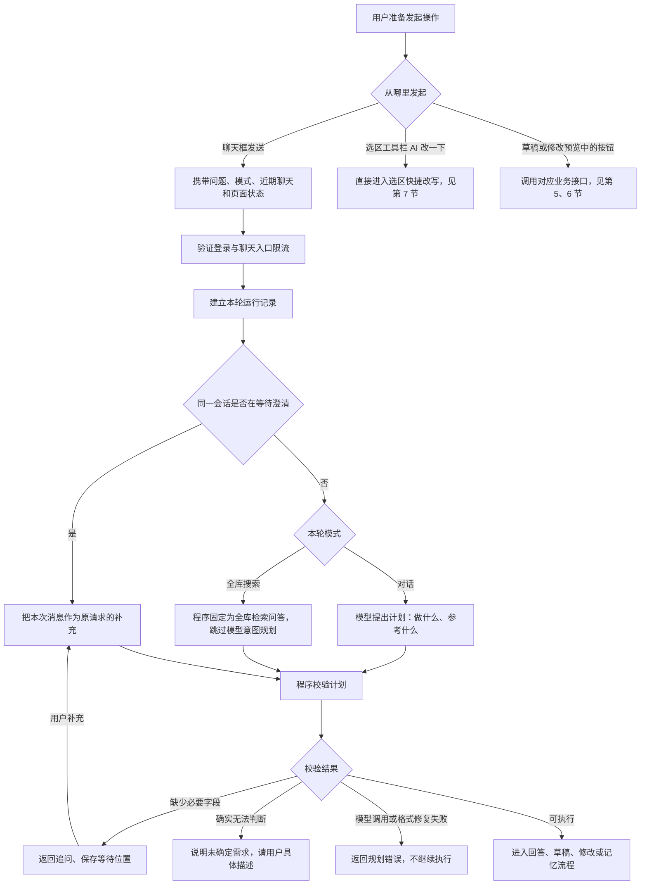
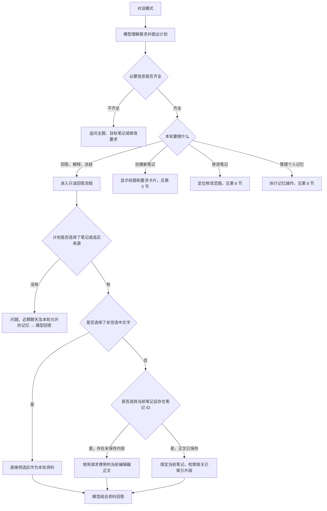
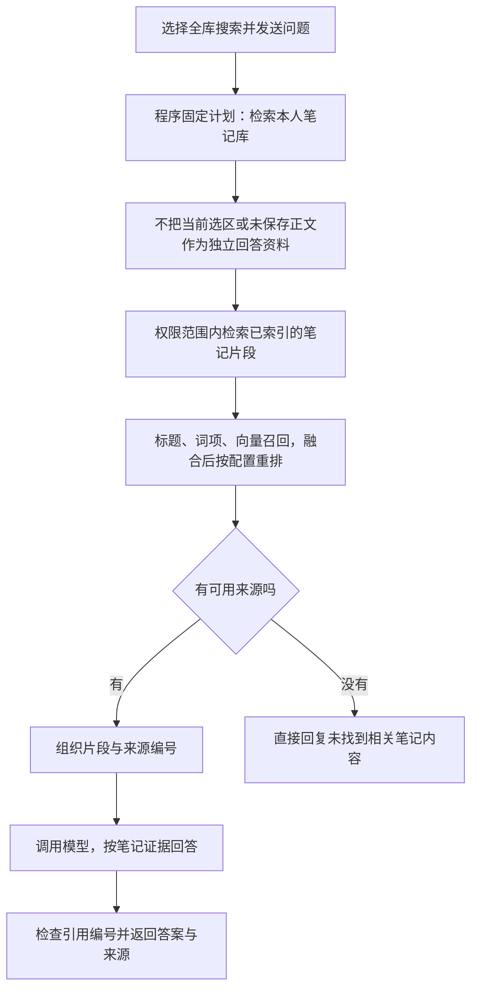
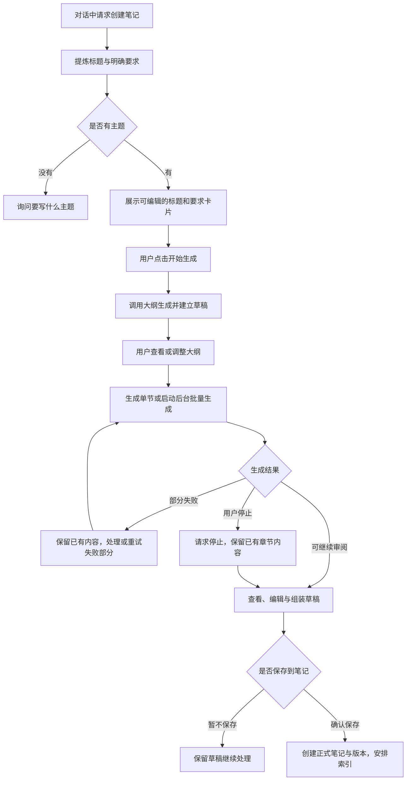
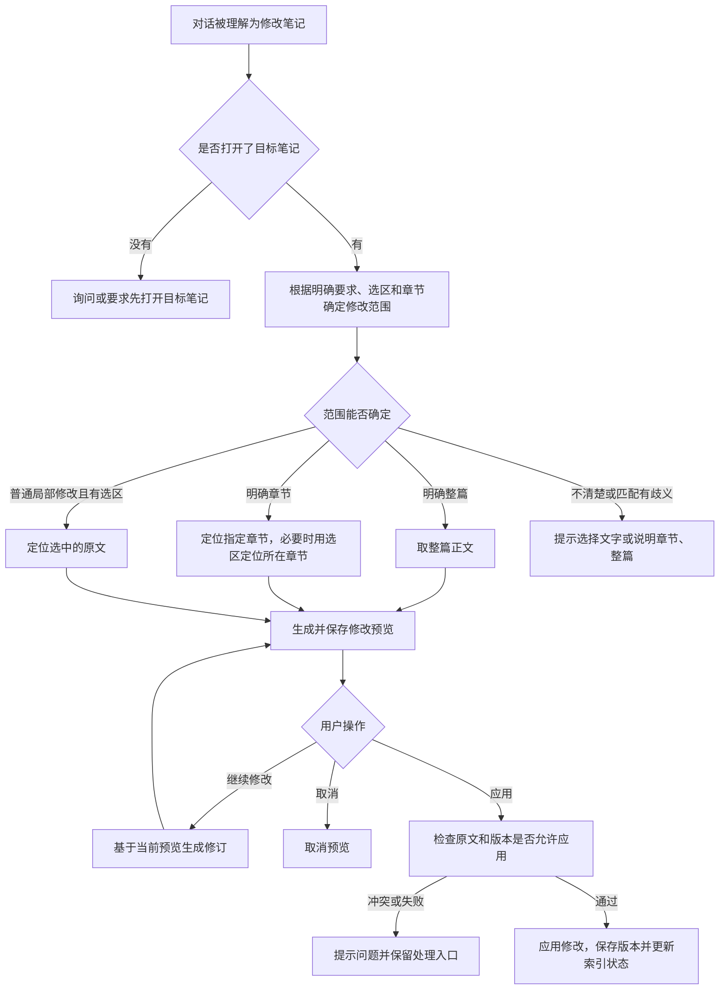
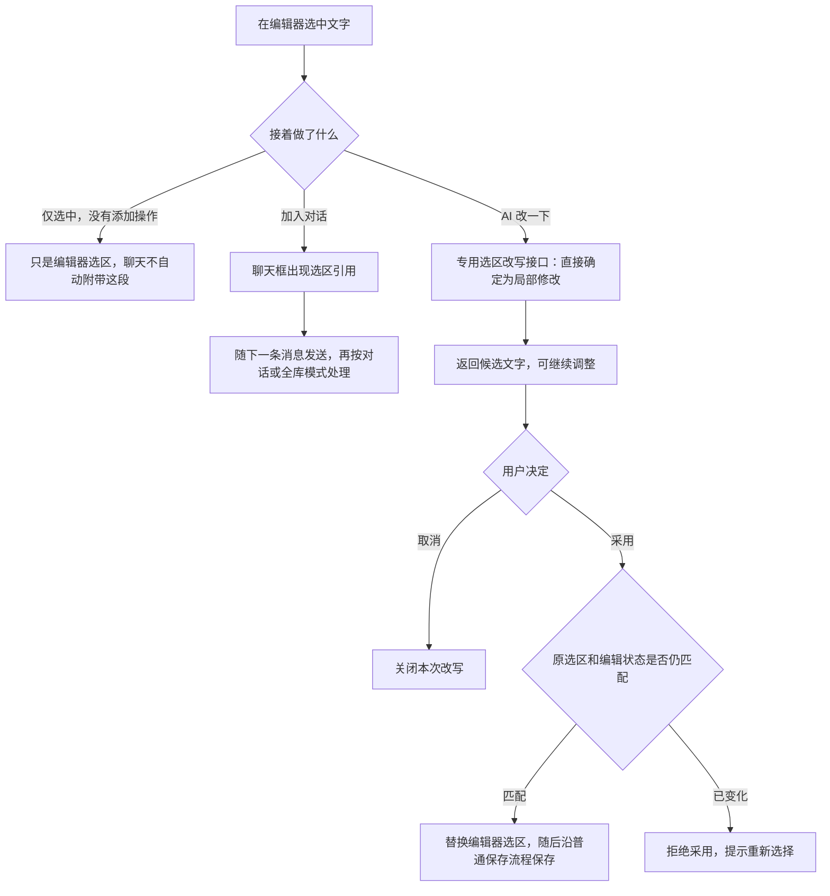
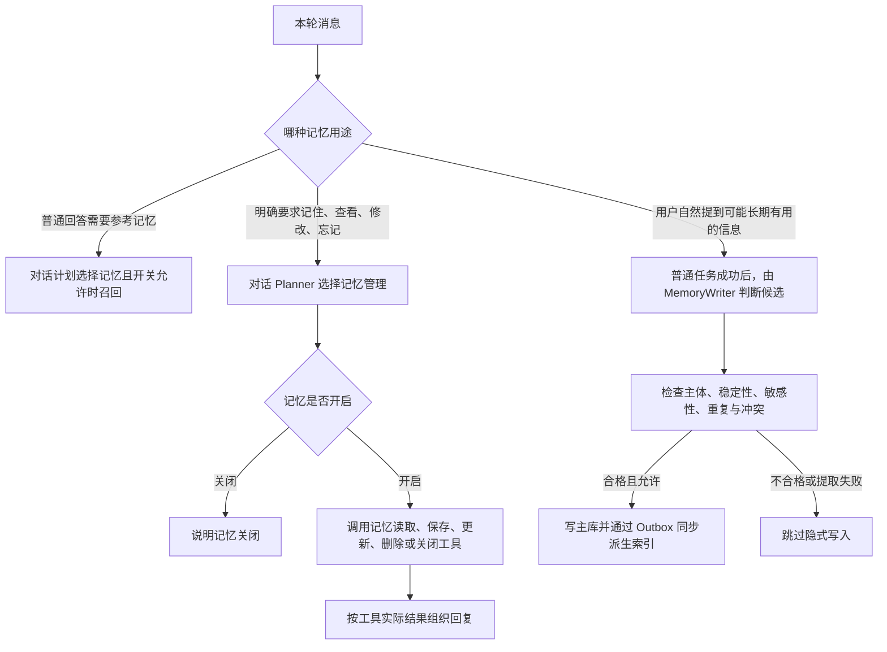
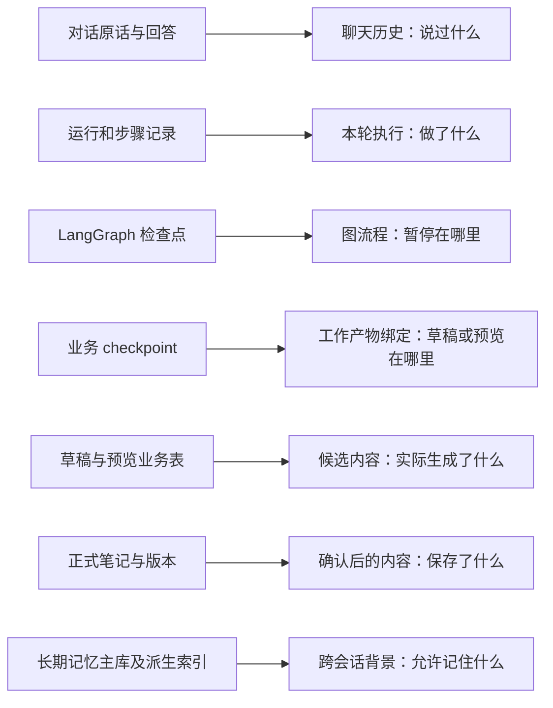

# NoteFlow 当前 Agent 全链路分支图解

日期：2026-10-27（Asia/Shanghai）。核对基线：`b3ba7b3`。

本文解释当前源码中的执行路径，帮助逐步理解 Agent。它不是未来重构方案，不意味着所有中文表达都已完成真实模型或生产端到端验收。图按正常的新请求展开；已有澄清等待时，优先续接原澄清。按钮入口、聊天入口、模型理解和程序校验分别标识。

## 1. 先认清三个不同的决定

| 决定 | 谁提供 / 判断 | 例子 |
| --- | --- | --- |
| 本轮使用什么模式 | 用户在输入框选择，后端强制约束 | 对话、全库搜索 |
| 想完成什么事情 | 对话模式由模型 Planner 理解，再经程序校验 | 回答、创建笔记、修改笔记、管理记忆 |
| 要参考哪些资料 | 页面提供可用信息，Planner 选择来源，实际服务再读取 | 选中文字、当前笔记、相关记忆 |

选中文字不会自动等于修改文字；打开一篇笔记不会自动等于每次都读取全文；发送当前正文不等于回答模型已经使用正文。

## 2. 从界面到 Agent 的完整入口

Planner 使用问题、近期聊天、当前笔记 ID，以及选中文字的受限片段理解请求。当前提示中的选区预览最多 320 个清理后的字符；实际选区问答可另行使用请求携带的选区文本。近期聊天是截取与限长后的内容，不等于自动检索全部聊天历史。

模式约束比模型的来源建议更强：`chat` 会剔除 `knowledge_base`；`ask_notes` 会强制只保留 `knowledge_base` 并转成问答。全库模式下即使问题措辞像创建 / 修改，也不会通过此入口分派到正式写入流程。

已知问题 AI-17：前端生成 `contextScope`，但当前后端只在 schema 中接收它，没有用于正式规划与校验。图不能把界面“引用当前笔记 / 移除引用”画成已实现的强制读取边界。

## 3. 对话模式：选择动作之后，才决定如何读取资料

图中的“选择来源”是最终校验后的 `context_sources`，不能只看页面是否高亮文字。若 Planner 同时选择选区与当前笔记，且当前笔记 dirty，则本轮资料可以同时包含选区和未保存正文；存在这类现场正文时，RAG service 直接返回现场资料，不再走索引检索。

对当前笔记的已保存内容，当前回答链路通常检索其中的相关片段，不保证将全文送给模型。“总结整篇”的质量不能仅凭识别到 current_note 就认定已覆盖全文。

对话中的普通回答可以读取已启用且计划要求的相关记忆；进入笔记 / 选区问答时，当前只读图会跳过长期记忆召回。参考笔记与记忆是不同来源，不能笼统理解成全部每轮都读取。

## 4. 全库搜索：固定走自己的笔记库检索

“全库”指当前账号可访问的笔记库，不是互联网；检索相关片段，不是把所有笔记全文拼进一次模型请求。打开着的笔记仍可能作为库中的正常命中出现，但不会限定只搜索这一篇。

全库模式强制 `context_sources=[knowledge_base]`。选中文字仍可能随前端请求发送，但不会作为这个模式的独立选区上下文；未保存正文不会通过该路径替换库内索引。即使已经保存，后台索引完成前也可能尚未参与新内容检索。当前全库模式不读取或隐式写入个人长期记忆，回答仍会接收近期聊天。

| 输入情况 | 当前源码处理 |
| --- | --- |
| 对话 + 未选中文字 + 普通问题 | 可以按通用问题回答，不自动检索全库 |
| 对话 + 未选中文字 + 明确问当前笔记 | Planner 选择 current_note 后，使用未保存正文或限定单篇检索 |
| 对话 + 选中文字并加入对话 + 解释这段 | Planner 选择 selected_text 后，使用选区资料回答 |
| 对话 + 选中文字并加入对话 + 修改这段 | Planner 判断修改后，进入修改预览；仍需实际范围检查 |
| 全库搜索 + 未选中文字 | 按问题检索笔记库后回答 |
| 全库搜索 + 已附选中文字 | 仍走全库检索，选区不是硬限制或独立资料 |

以上含模型理解的行是对应计划执行时的路径，不是对任意中文表达的百分之百成功承诺。

## 5. 创建笔记：聊天受理与正文完成是两段工作

返回创建卡片时，本轮聊天 run 可以已完成，但草稿可能还没建立或正文尚未生成。大纲、章节、批量生成、组装和保存通过专门接口推进。草稿状态保存在业务表，LangGraph 配合维护流程检查点；不能把所有业务和模型调用都画成仅由一个图节点自动完成。

## 6. 修改笔记：定位范围、预览、再决定提交

没有选中文字不会自动等于修改整篇。当前范围解析会使用明确整篇 / 章节措辞、已附选区、明确章节定位；只是在阅读某一节，不代表授权修改那一节。措辞明确要求整篇或整节时，即使有选区，也可以按明确范围处理。

聊天修改入口会通过工具事件通知前端，再由前端同步相关笔记并调用创建预览接口，因此“聊天说正在生成修改预览”和“预览已成功生成”是不同阶段。自然语言“应用吧 / 取消 / 继续修改”还受 AI-13 限制；不能用旧执行分支的存在证明当前规划入口能到达它们。对应按钮和接口仍有独立能力。

## 7. 选中文字：两个入口必须分开理解

快捷改写不先经过聊天 TurnPlanner，也不创建同一套持久修改预览；它使用编辑器选区快照，支持编辑器撤销。两种入口的取消、保存和恢复语义不能混为一谈。

## 8. 记忆：读取、显式管理、隐式提取是三件事

当前只读图在回答之后、finalize 之前等待隐式提取；不能把索引 Outbox 异步等同于提取已移到后台。普通问候也不是每次必读基础称呼，仍关联 AI-10 / AI-11。显式记忆结果成功后再组织回复，隐式提取失败原则上不应把已成功的普通回答变成失败。

## 9. 停止、重试、澄清和恢复

| 情况 | 当前处理与边界 |
| --- | --- |
| Planner 首次输出格式不合格或低置信度 | 有限进行一次修复请求；仍失败返回 planner_failed，不能当作语义 unknown |
| 缺必要主题 / 目标 / 修改要求 | 保存澄清等待位置；同会话下一条消息用于补充原计划；澄清期间有明确取消处理 |
| 普通回答失败 | 保留已显示部分和错误；符合条件时用原请求快照重试；有活动草稿 / 预览等情况不开放普通回答重试 |
| 回答重试 | 后端 retryAnswerOnly 防止重放写操作，并抑制隐式记忆写入；不是重试整个业务任务 |
| 点击聊天停止 | 前端取消读取并请求取消 run / 等待 checkpoint；不能据此保证外部模型瞬时停止或已计费调用撤回 |
| 点击草稿停止生成 | 走独立的草稿停止接口，设置取消请求、取消活动生成、保留已有正文 |
| 预览应用 / 取消 / 修订 | 通过预览按钮与专用接口执行；与聊天停止不同 |
| 返回历史会话 / 工作区 | 读取持久聊天、草稿、预览与相关 checkpoint；已有恢复基础不代表全部多轮自然语言续接已验收 |
| 直接输入“继续 / 应用吧 / 取消刚才的” | 旧业务分支存在，但正式 TurnPlan 映射未接通对应意图，沿用 AI-13；不要画成已可靠可达 |

## 10. 不同层保存了什么

这些记录关联使用，不能认为“聊天结束”就代表“整篇正文生成完成”，也不能把聊天历史、图检查点、正式笔记或长期记忆当作同一种数据。

## 11. 源码位置与本轮验证

关键入口：

- [聊天框发送与引用状态](../../src/components/AIPanel.tsx)、[请求快照 / 工具动作 / 重试与停止](../../src/store/index.tsx)。
- [规划器与模式校验](../../server/app/services/turn_planner.py)、[澄清图](../../server/app/agent/langgraph_turn.py)、[聊天分派](../../server/app/routers/agent.py)。
- [只读回答与来源映射](../../server/app/agent/langgraph_readonly.py)、[现场资料 / 单篇 / 全库读取](../../server/app/rag/pipeline/service.py)。
- [草稿 API](../../server/app/routers/drafts.py)、[修改范围与预览 API](../../server/app/routers/edits.py)、[快捷选区改写](../../src/components/SelectionQuickEdit.tsx)。
- [草稿图](../../server/app/agent/langgraph_draft.py)、[编辑图](../../server/app/agent/langgraph_edit.py)、[业务与图适配](../../server/app/agent/write_runtime.py)。

本轮使用 AST 提取的正式规划函数、Pydantic 契约和只读来源映射函数进行离线合成核对，替换模型 / RAG 调用为拒绝或捕获替身，不连接数据库：确认 contextScope 不影响正式规划提示、全库计划不调用模型 Planner 且只保留 knowledge_base、对话剔除 knowledge_base、修改缺目标会澄清、选区 / 当前笔记 / 全库映射分别成立。模型与数据库实际调用均为 0，product_fixed=false。初次隔离执行因 Pydantic 类型所在临时模块未注册失败，注册后通过，不为诊断改产品。

图解与文档链接 / 差异检查不等于浏览器、真实模型、邮件、数据库或生产验收。未修改产品代码、样式、模型、依赖或用户数据。AI-17 新记为未解决；AI-10 / AI-11 / AI-13～16 等原状态不提高。
