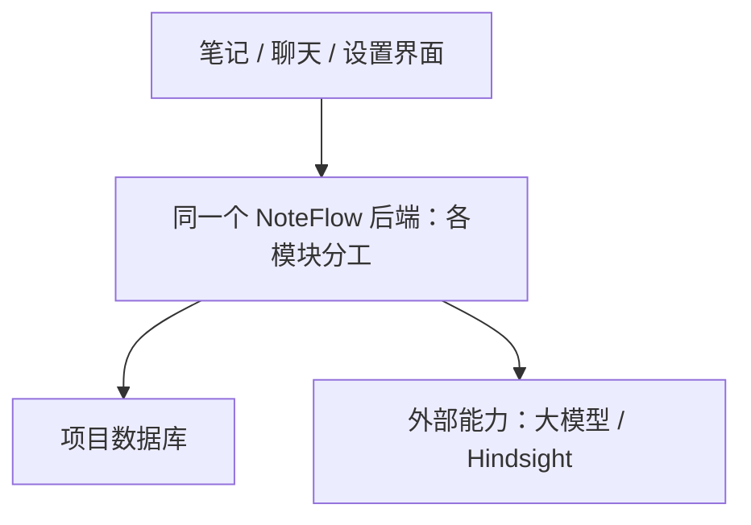

# NoteFlow 架构取舍与成熟度复核

日期：2026-10-31。范围：当前记忆接入、与其他模块的调用边界及整体分层建议；不是全仓库逐项生产审计。本轮仅审查和记录，没有修改产品代码、运行数据或部署。

## 结论

保留应用内部统一的记忆服务入口是合理选择；它负责项目自己的账号范围、开关、任务与删除生命周期。无需把“记忆管理员”建设成单独的平台、另一个 AI Agent 或独立部署服务。“记忆模块 / 记忆服务层”更准确。

当前项目适合一个后端按职责分模块，使用独立的模型与 Hindsight 服务。模块可以独立维护，不必为每个模块增加网络调用、服务器或数据库。是否进一步拆服务，应由真实的扩容、故障隔离、团队发布需求决定。

这是建议的职责与部署边界概览，不表示当前代码的每个边界已经实现完整。

## 判断设计是否值得保留

| 设计 | 应解决的实际问题 | 当前判断 |
| --- | --- | --- |
| 统一记忆入口 | 聊天、编辑和设置遵守同样的账号、开关及删除规则 | 保留，在现有后端内部实现 |
| 引擎适配器 | 业务代码无需了解厂商字段、协议和错误 | 保留；当前转换边界仍需收拢 |
| 来源控制与队列 | 保存结果可核对，失败可重试，旧任务不能复活删除内容 | 有实际需求，已做本机场景验证 |
| 原生图谱与后台 | 提供关系检查能力，减少重复开发 | 复用，编辑动作须遵守应用规则 |
| 每模块独立服务 | 独立扩容、独立发布等 | 目前没有足够依据再增加部署单元 |
| 任意切换多个记忆引擎 | 解决明确的迁移 / 替换需求 | 有边界目标即可，不能宣称已经随插随换 |

## 当前需要坦诚说明的限制

1. **引擎边界仍有泄漏。** `memory/engine.py` 的 list / recall / get 返回开放 dict；`memory/gateway.py::record/read/process` 识别 `text`、`document_id`、`fact_type`、`state=invalidated` 等 Hindsight 语义，process 还有具体引擎名判断。`configured_engine()` 固定构造 Hindsight。存在协议和可注入替身，不等于已经验证任意生产引擎可替换。应让适配器返回归一化事实与状态，治理层只使用本项目契约；真实替换还包括数据、规则和删除语义迁移。沿用 AI-18 的模块解耦复核，不新增同义问题。
2. **人工修订保护偏保守。** 当前手改一条内容即设置账号级 `reviewNewFacts=True`，后续所有自动新事实都需确认。该行为已记录并验收，能保护已有修订，但是否应只对相关冲突采取确认，需要产品试用与语义评测。它是当前取舍，不应包装成普遍成熟的最优策略。
3. **运行正确性与内容质量分别验收。** 本机隔离、关闭、删除、故障、队列等场景有证据；长期抽取准确率、近似重复、复杂矛盾、成本与规模、生产恢复仍不能由单元测试数量代替。沿用 AI-14 与实现记录中的未验收边界。
4. **整套项目尚需按模块复核。** 本轮没有逐一检查正文版本事务、所有 Agent 分支、全套 RAG 质量、生产认证 / 运维等，不作整套系统已经成熟的判断。

## 后续每项设计都要说明的五件事

1. 解决哪个具体使用问题，去掉它会有什么后果？
2. 这部分负责什么，哪份数据由它最终负责？
3. 其他模块通过什么入口调用它，需要知道多少内部细节？
4. 失败、重试、关闭、删除时，用户实际会看到什么？
5. 增加多少开发和运行成本，有哪些真实验证，哪些仍是假设？

优先顺序：明确用户流程和数据归属，核对现有边界与失败行为，补齐实际缺口，再决定是否重构或增加组件。避免只凭架构名称或厂商功能清单推进修改。

## 公开设计依据

- [微软：外部系统的适配与隔离边界](https://learn.microsoft.com/en-us/azure/architecture/patterns/anti-corruption-layer)：转换层可位于应用内部，也可独立部署；讨论了引入成本和适用条件。此模式对应接口转换，不代表应把全部业务规则塞入适配器。
- [Martin Fowler：Monolith First](https://martinfowler.com/bliki/MonolithFirst.html)：提出先保持简单、逐步认识模块边界的理由，也明确这种建议有适用条件，不能当作所有项目的定律。
- [Hindsight：每用户一个记忆库的官方示例](https://hindsight.vectorize.io/cookbook/recipes/per-user-memory)：展示应用负责用户到 bank 的对应、召回及回答流程；它不能替代 NoteFlow 自己的权限、开关和用户删除承诺。
- 当前实现证据见 [记忆接入与验收](memory-v1-implementation-2026-10-31.md)。
