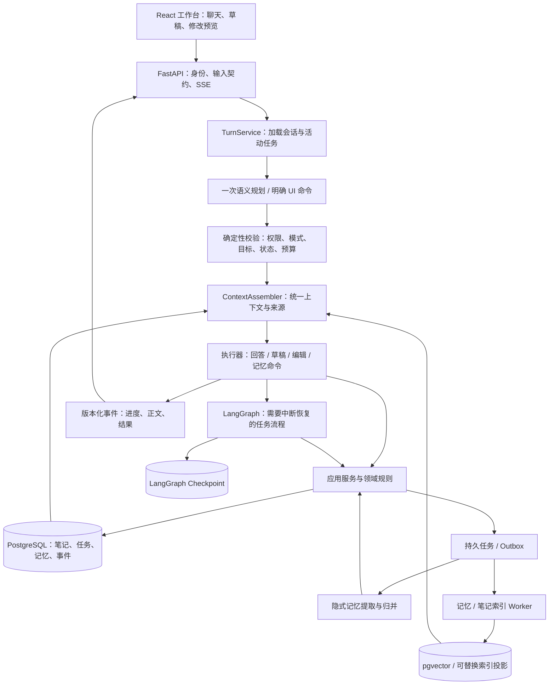

# NoteFlow 整体架构、记忆与意图识别重规划

日期：2026-10-24（Asia/Shanghai）

审查基线：`c7ec47e`；状态：架构提案，未实施。本文延续 [10 月 15 日记忆审查](memory-context-review-2026-10-15.md)，扩展到任务运行、意图协议、框架取舍与迁移验收。代码证据与设计建议分开表述，不把方案完成视为功能修复。

## 1. 建议决策

**重划应用层架构，保留主技术栈；先统一任务、上下文和记忆生命周期，再用评测决定是否替换组件。**

建议采用模块化单体：React / Tiptap 前端、FastAPI 应用服务、LangGraph 任务编排、PostgreSQL / pgvector 业务与派生索引、现有持久任务 / Outbox。后台工作可独立进程部署，但先不拆独立数据库和微服务。

| 对象 | 建议 | 依据与条件 |
| --- | --- | --- |
| React / Tiptap / FastAPI / PostgreSQL | 保留 | 本次发现的核心问题在业务契约，不在这些框架提供的基础能力；未做新一轮依赖安全审计 |
| LangGraph | 保留，收敛职责 | 用于中断、恢复与任务步骤；业务规则由应用服务拥有，图快照不充当全部业务真相 |
| Mem0 | 先改为可替换的记忆索引适配器 | 当前提取、规范键、冲突与审计已由 NoteFlow 实现，Mem0 的实际主要职责是派生存储与排序 |
| LlamaIndex | 核实收益，保留适配边界后再评估精简 | 当前主检索流水线基本由项目自己实现，不能因服务类名叫 LlamaIndex 就认定框架已承担整个 RAG |
| 新的 Agent 框架 | 暂不迁移 | 改框架不会自动补齐基础上下文、续接协议、删除一致性和评测覆盖 |
| 图数据库 / Graphiti | 等关系型需求出现后再验证 | 当核心问题变成跨人物、项目、事件的多跳和时间关系时才有明确收益 |

约束暂按仓库记录中的个人 / 小团队自部署、有限运维资源规划；历史 2C2G 部署记录只作为成本约束，不当作当前容量测量。若目标已变成多组织协作或本地优先离线同步，需另外评估权限模型、同步协议与部署边界。

## 2. 当前架构的有效基础

已经存在并值得保留的能力：

- 唯一模型语义规划 `TurnPlan`、Pydantic 校验、错误与语义 unknown 分离。
- 普通聊天与笔记库模式有明确边界，普通聊天不会自动搜索整个笔记库。
- PostgreSQL 保存用户记忆、状态与审计；Mem0 作为派生投影，Outbox 同步。
- 笔记 RAG 已有 AST 分块、版本指针、Title / BM25 / Vector 融合、可选重排和引用校验。
- 草稿 / 修改预览有业务持久化；LangGraph 有检查点和中断恢复机制。
- 已有账号过滤、候选安全检查、重试回答不得重复执行写操作等防护。

这说明重规划应围绕现有资产逐步收敛，避免同时重写编辑器、数据库、检索与运行时。

## 3. 已核实的主要断点

| 断点 | 正式证据 | 实际影响与证据边界 |
| --- | --- | --- |
| 基础用户背景依赖本轮语义来源选择 | `turn_planner.py:validate_turn_plan`；`langgraph_readonly.py:memory_recall` | AI-10 的历史真实运行已证明：有效称呼存在，但问候计划未选择 user_memory，最终未读取 |
| 记忆先截断、后过滤，向量结果受预候选 ID 限制 | `memory/domain.py:find_memories`；`memory/runtime.py:resolve_memory_read` | AI-11 已有合成正式函数复现；既可能被 pending 挤占，也可能丢掉预候选外的有效语义命中 |
| 聊天、生成、编辑采用不同记忆入口 | `memory/agent.py`、`memory/context.py`、`memory/domain.py`；`routers/edits.py` | 同一账号的上下文资格、限额与格式会随入口变化，难以形成统一保证 |
| 自然语言任务续接与新协议脱节 | `PrimaryIntent`、`routers/agent.py:_context_plan_from_turn_plan`、旧执行分支 | 新协议只能映射到 5 种执行意图；不会产生 resume_work / note_draft_continue / confirm_action / cancel_action / note_edit_revise / history_recall。已确认协议不可达，不等于所有按钮恢复 / 取消都失效 |
| Planner 没有接收到完整活动任务语义 | `_planner_messages` 只序列化当前笔记、选区、近期历史等 | schema 虽有 activeDraftId / Topic，正式提示构造未传入这些字段，更未加载服务端权威任务快照；不据此宣称已经复现某次误操作 |
| 长期记忆提取仍在回答结束路径上 | `langgraph_readonly.py:memory_writer` 在 answer 与 finalize 之间 await | 文字输出完仍可能等待模型提取；现有 Outbox 异步的是索引同步。未实测其真实耗时占比 |
| 姓名和偏好称呼共用一个规范键 | `domain.py:CANONICAL_KEY_ALIASES` 将 identity.nickname 映射到 identity.name；identity 更新按类型找记录 | “我叫张三，以后叫我小张”需要两个可并存概念，当前规范化会合并它们；未修改或迁移已有用户数据 |
| 质量基线与正式模型语义路径不一致 | `run_memory_safety_eval.py` 调用规则 extract_memory_candidates / fallback_context_plan | 12 条基线通过不能证明正式模型提取、意图识别、多轮召回和删除传播质量；现有模型替身测试仍有协议回归价值 |

另有实现层风险需在改造时测量：`find_memories` 先把匹配账号集合载入 Python 排序；记忆管理还存在按条数限制的列表 / 召回语义；历史性能报告的首字指标是直接调用 Provider，不包含完整 Planner → Context → Answer。不能据此给现有端到端延迟或大规模容量下结论。

## 4. 目标总架构

先建立清楚的调用边界，再移动文件。Router 负责协议转换；TurnService 负责本轮协调；Memory / Task / Note 应用服务管理事务和状态；Provider 只适配外部调用。模块间共享身份、来源、版本和事件协议，不共享一份任意增长的 dict。

LangGraph 检查点保存执行位置，草稿 / 预览等业务表保存实际结果；任务视图引用这些结果与版本，不另存一份可独立修改的正文。现有 `agent_checkpoints` 可先演进成任务绑定与状态入口，无须第一步再建平行的任务真相库。官方也区分线程检查点与跨线程长期数据；是否使用其 Store，是适配选择，不能覆盖 NoteFlow 的业务与权限模型。[LangGraph 持久化说明](https://docs.langchain.com/oss/python/langgraph/persistence)

## 5. 把“记忆”拆成用途不同的数据

以下是逻辑边界，不要求立即拆成六套表或六个服务。

| 数据 | 回答的问题 | 建议来源 / 保存方式 | 使用方式 |
| --- | --- | --- | --- |
| 当前轮上下文 | 用户刚说什么、选了哪里 | 请求、当前编辑器快照；标识未保存内容 | 本轮有效，不能自动升级成长期事实 |
| 会话记忆 | 刚才谈到哪、代词指什么 | 服务端消息 + 可重建摘要 | 最近消息与摘要组合；不能只依赖前端传回的 8 条历史 |
| 工作记忆 / TaskState | 在做哪个任务、下一步是什么 | 草稿 / 编辑状态、任务绑定、已确认要求、版本 | 确定性续接，不能用向量相似度猜任务是否已保存 |
| 个人事实与偏好 | 如何称呼、表达风格、长期约束 | 结构化记忆记录与来源证据 | 少量基础字段精确读，其他按任务检索 |
| 事件记忆 | 何时做过什么、结果如何 | 用户陈述或已提交业务事件 | 按事件时间 / 项目检索，保留来源和历史有效性 |
| 笔记知识 | 用户文档里写了什么 | 原笔记 + 版本化 RAG 派生索引 | 按权限与用户选择提供事实证据及引用 |

长期偏好可以修饰表达，不得冒充笔记里的事实；用户笔记中的命令文字不得变成系统权限。已取消任务可形成历史事件，但不能恢复为进行中的 TaskState。项目背景应能绑定具体 project / note / task ID；当前固定的 note_generation / learning 等 scope 是用途，不足以隔离两个具体项目。

会话摘要必须保存 `covered_through_message_id`、摘要版本和来源范围，保留最近原始消息；纠错、删除和任务切换要使摘要失效或重建。摘要属于派生内容，不能再次被提取成新的第一手用户事实。

## 6. 统一 ContextAssembler

接口先形成结构化 `ContextBundle`，最后按模型能力渲染消息；不要让三个入口继续分别拼字符串。

建议结果字段：`purpose`、`profile_items`、`relevant_memories`、`task_snapshot`、`conversation_summary`、`recent_messages`、`note_evidence`、`source_refs`、`read_states`、`policy_version`、`memory_epoch`、`token_usage`。

每条信息保留类别、来源 ID、版本、适用范围和可信等级。读取状态至少区分 disabled / not_requested / found / empty / degraded / error。未查询不能解释为“你从没告诉过我”；读取失败也不能解释为“数据库没有记录”。

建议组装顺序：

1. 先检查身份、记忆开关、目标权限与用途。基础字段读取可与语义规划并行。
2. 通过规范键确定性读取少量有效称呼 / 语言 / 表达偏好。称呼取 preferred_name 优先；无称呼时不编造，也不必在问候中主动追问。
3. 按任务需要读取相关长期记忆、活动任务、会话上下文和笔记证据。
4. 处理冲突与重复，再执行 token 预算；对模型明确区分数据来源和指令边界。
5. 输出选择 / 丢弃原因与读取状态，普通诊断日志不记录个人正文。

优先级为：系统与业务权限 > 本轮明确要求 > 当前已确认任务约束 > 适用的长期偏好；事实冲突还必须比较主体、作用域、来源和有效时间，不能仅以“最新一段文字”覆盖所有历史。

首版可从基础画像 200～400 tokens、相关记忆 800～1200 tokens 起试；这是实验预算，不是验证后的最优参数。历史、任务和证据另设配额，预留输出与安全余量，优先使用当前模型 tokenizer / usage 校准，避免用字符数直接代表中文 token。

全库问答继续保留现有事实隔离。是否允许语言 / 格式偏好参与，需作为单独产品策略验证；不能在重构时悄悄把个人经历放入笔记答案。生成 / 编辑使用写作偏好时，也不能默认把姓名等个人信息写进正文。

## 7. 记忆读取重做为两条通路

**精确字段读取：** user + scope / entity + canonical_key + active + 未删除 + 未过期 → 冲突选择 → 小预算。无需向量搜索“我叫什么”。

**相关记忆读取：** 在账号与允许作用域内，关键词 / 向量各自产生较宽候选 → 回主库核对权限、状态、时效和版本 → 融合、去重 → 最终 Top K 与 token 预算。

第一阶段在现有 Mem0 接口内重排流程即可，不必等换存储。索引只能返回候选；如果索引里有主库已删除记录，必须舍弃。主库校验之后的候选不足，应有受限补召回或明确降级，不能回退到全量画像。

若后续采用原生 pgvector，沿用独立 `memory_embeddings` 投影，绑定 memory_id、source_version、provider、model 和 dimension。SQL 先约束身份与有效范围；近似检索与过滤组合的召回率仍需测量，不能因为写了 WHERE 就保证候选充足。官方说明了 HNSW / IVFFlat 过滤与迭代扫描的取舍。[pgvector 官方仓库](https://github.com/pgvector/pgvector#filtering)

记忆列表管理应使用独立分页查询；“列出全部”不能复用最多 8 条的回答召回函数。

## 8. 记忆写入、纠错与遗忘

### 8.1 显式命令同步提交，隐式提取持久异步

用户明确“记住、修改称呼、删除、关闭”时，先在主库完成事务，再明确反馈结果；不等待向量索引同步才生效。含糊删除需先确定对象，精确目标明确时按现有产品授权执行，不为每次低风险记忆更新新增确认弹窗。

自然聊天中的长期信息走持久提取任务。主任务结果与待提取事件应由应用服务安排可靠落库；如果队列暂不可用，记录可重试状态，主回复是否成功独立判定。不要用进程内 `create_task` 代替持久化。

提取任务只引用当前用户源消息和必要的指代上下文，模型生成候选，领域层再做主体、安全、作用域、时效、规范键、冲突与确认策略。最终事实写入与索引 Outbox 同事务。当前 Mem0 `add(..., infer=False)` 已关闭其提取，因此不能误称现有路径存在两轮 Mem0 / NoteFlow 重复提取。[Mem0 infer 说明](https://docs.mem0.ai/core-concepts/memory-operations/add)

### 8.2 最小必要数据演进

保留 `user_memories` / events，逐步将关键检索字段从 tags 提升为唯一权威字段：`subject`、`canonical_key`、`value_json`、`memory_layer`、`scope_kind / scope_id`、`source_message_id / source_event_id`、`observed_at`、`valid_from / valid_until`、`version`、`extractor_version`。已有同义字段先制定兼容规则，不双向随意写入。

姓名与称呼分为 identity.name / identity.preferred_name；语言、语气、长度分别表示，避免一个 answer_style 字符串承载互相独立的偏好。“我今年 20 岁”应带观测时间，不能未经依据推成准确生日，也不能永远按 20 岁回答。

首版不需要完整事件溯源系统。业务表保留当前态，事件记录原因与来源；单值键在同一主体 / 作用域内保证一个有效当前值，多值兴趣 / 历史事件另设归并规则。修正保留事件历史，不用高相似度把两个不同经历合并。

### 8.3 幂等与版本屏障

- 命令执行用账号 + client_command_id 去重；同一确认重放返回原结果。
- 提取用源消息 + 提取版本 + 规范键 / 作用域去重，同时核对源消息顺序，旧消息不能覆盖新纠正。
- 关闭 / 删除时更新 memory_epoch 或相应范围的 tombstone；后台任务在提交前加锁或版本比较，拒绝跨过屏障的旧提取。重新开启不能自动恢复关闭前的旧任务。
- 索引任务携带事实版本，处理前后核对当前状态；外部调用成功而本地提交失败时，需对账清理重复 / 孤儿投影，不能把 at-least-once 宣称为 exactly-once。
- 显式更名下一轮按主库立即可见；隐式提取完成前由近期会话承接当前信息，但不能谎称已持久记住。

“不再参与回答”和“物理清除所有副本”必须有不同验收。遗忘还需检查缓存、会话摘要、旧提取任务、检查点快照与索引；审计正文及备份的保留 / 清理规则需明示。不能只把主表标 deleted 就承诺所有历史副本已消失。

## 9. 意图识别应升级成任务理解

保留一次语义规划；将当前单一主意图扩展为有约束的 `TurnDecision`。不以增加第二个“是否需要记忆”模型为前提。

建议协议包含：

| 维度 | 含义 |
| --- | --- |
| task_relation | new / continue / revise / confirm / cancel / switch / none |
| target | 服务端候选中的 task_id / note_id / preview_id，必要时带选择范围 |
| operation | answer / retrieve / create / edit / resume / apply / cancel 等受限能力 |
| context_request | 相关记忆查询与笔记范围；基础画像仍由固定策略决定 |
| explicit_memory_commands | 与主任务并存的少量明确记忆操作 |
| constraints | 用户明确要求、原话位置、缺失字段、冲突字段 |
| decision | execute / clarify / unknown；系统失败用独立错误状态 |

第一版最多一个文档主动作 + 少量明确记忆操作，不开放任意工具 DAG。比如“以后回答简洁些，帮我生成 Redis 教程”同时包含持久偏好与创建任务；“这次简短些”只作用于本次任务。每个动作独立报告提交结果，避免部分成功时统一声称完成。

规划前从服务端加载活动任务摘要、允许动作、目标版本和近期会话；浏览器当前草稿 ID 只是线索，需验证所属账号和任务状态。模型从有限合法目标中选择，不能生成 user_id 或任意可执行工具名。选区 / 未保存正文是本轮材料，不替代已保存笔记版本。

“继续”只有一个合法活动任务时才直接续接；多个候选或目标已变化时澄清。“可以，继续”不能跳过尚缺的必填字段。“先不做这个，帮我写另一份”应允许任务切换；当前澄清恢复强制保留原主意图的行为，需要随协议升级重新约定。

任务更新还须遵守已确认的草稿契约：创建时要求与当前正文补充有不同生效范围；新主题建立新任务，不能借自然语言续接绕过已有正文替换确认或覆盖已锁定的原始要求。

Validator 独立检查模式、权限、状态转换、目标版本、必要参数和副作用授权。模型自报 confidence 只供校准参考；当前统一 0.55 阈值不能当成误操作概率或安全保证。根据错误类型区分澄清、拒绝执行和系统重试。

## 10. 路由方式与模型分工

建议采用“明确命令直达 + 语义计划 + 确定性执行”的组合。

- 用户点击“确认此预览”“停止此草稿”“查笔记”等按钮，已有明确动作和目标 ID，直接校验执行；无需再次让模型猜意图。
- 自然语言请求由唯一 Planner 判断；保留普通聊天不偷偷升级全库检索的规则。
- 基础背景读取与权限由后端策略保证，不依赖关键词补丁或第二轮语义规划。
- 暂不改成所有请求都进入自由 ReAct / 多 Agent 循环。只有未来出现真正开放、多工具探索任务，再对限定场景评估工具选择循环。

模型角色在 Provider 层分别配置 Planner、Answer、Extractor、Embedding、可选 Reranker，而不是复制五套业务调用。Planner 优先结构稳定、低延迟；回答优先内容质量与流式；提取重视来源、纠错与成本，可后台批处理。具体是否换模型、是否关闭思考、是否用工具调用代替 JSON，必须用当前供应商能力和固定数据集做兼容评测，本文未验证新模型。

## 11. 框架替换的具体取舍

### LangGraph：保留比重写划算

已有中断、PostgreSQL checkpointer 和草稿 / 预览图。迁移到手写状态机或其他 Agent 框架，需要重做恢复、事件与错误映射，还不能自动获得业务事务一致性。应先让图调用统一应用服务，明确每个节点的副作用与重试语义，再减少路由器中的业务协调。

替换触发条件应是经过测量的依赖 / 恢复成本，或产品最终只剩无持久任务的简单单轮调用。Pydantic AI / pydantic-graph 有类型化图能力，可列为轻量对照，但需重新验证现有 DeepSeek、SSE、持久化与恢复，不因 API 简洁就直接迁移。[pydantic-graph 官方文档](https://ai.pydantic.dev/graph/)

### Mem0：最值得做可替换对照

目前 NoteFlow 已拥有记忆提取、政策、规范键和事件；Mem0 用 `infer=False` 接收结果、保存向量投影并检索。因此它不是当前记忆能力的唯一承载者。保留它有现成适配和部署经验；原生 pgvector 则可能减少外部 ID 映射和依赖，并让权限 / 版本过滤更直接。这些收益仍需测量。

先定义 `MemoryIndex.search / upsert / delete / reconcile`，分别用现有 Mem0 和原生 pgvector 在同一合成语料上比较召回、隔离、删除传播、p95、资源、依赖与运维成本。影子阶段只比较读取或隔离派生索引，不让两套引擎各自提取和修改用户事实。先修候选流程，否则更换引擎仍会继承 AI-11。

### LlamaIndex：按实际调用价值决策

本次静态检索中，业务代码的 `llama_index` 导入仅在 `to_llamaindex_nodes` 适配函数；该函数未见生产调用。`LlamaIndexRagService` 实际调用 NoteFlow 自有 retrieve_candidates / rerank_with_fallback / build_context。框架支持 Document / Node，但这不证明本项目已实际使用完整引擎。[LlamaIndex 官方说明](https://developers.llamaindex.ai/python/framework/module_guides/loading/documents_and_nodes/)

建议先把主服务命名与真实职责对齐，再比较保留适配器与精简依赖的成本。不要为了“用了框架”把现有权限、稳定引用与版本索引迁回通用黑盒；也不要仅为去依赖重写已经通过评测的 RAG。

### Graphiti / 图谱：解决另一类问题

Graphiti 面向增量更新的时序实体 / 关系图，适用于“谁参与哪个项目、关系何时变化”一类问题。[Graphiti 官方介绍](https://help.getzep.com/graphiti/getting-started/welcome)

当前姓名遗漏、任务续接和先截断问题不需要图数据库解决。只有真实业务出现难以用结构化事实 + 事件检索回答的多跳关系，且专用评测证明提升足以覆盖实体消歧、提取调用、额外存储与运维，才引入隔离 PoC。厂商公开 benchmark 不等于 NoteFlow 中文语料的结果。

## 12. 性能与可观测性

当前普通聊天的简化关键路径：Planner（可能修复一次）→ 记忆 / 笔记上下文 → 首个回答 token；回答后还可能等待 Extractor（可能修复一次）→ agent_done。不能把一次聊天当作只有一次模型调用。

建议分别测量 request→ack、planning、context、provider_first_token、answer_last_token→done、extract_queue_lag、index_sync_lag，以及每种模型角色的用量。前端尽早接收运行 / 规划状态，进度事件不能冒充正文首字。

基础字段读取与规划并行后，相关阶段由任务决定再读取；隐式提取退出前台关键路径。吞吐通过限并发、任务优先级和持久积压控制，避免后台提取挤占回答与笔记保存。现有 Outbox 可复用投递机制；提取属于长模型任务，应有独立类型、超时、租约 / 心跳与死信，避免单一串行索引 dispatcher 被长任务阻塞。

先记录实际 p50 / p95 和错误分布，再定 SLO。验收可以要求“数据库上下文开销和完成尾延迟不回退、首字相对旧链路改善”，但不能在没有实测时承诺固定秒数。低配部署先共用 PG、控制 worker 并发，待实测需要再拆进程 / 扩容。

## 13. 评测必须与架构一起改

| 层级 | 必测内容 | 不能替代什么 |
| --- | --- | --- |
| 纯规则与协议 | schema、规范键、状态转移、安全过滤、幂等 | 不代表真实模型理解正确 |
| 模型语义 | 意图 / 目标 / 约束 / 临时与长期 / 第三方 / 更正 / 多义表达 | 单看 JSON 合法率不能说明任务执行正确 |
| 记忆读取 | 基础字段、预候选外命中、规模增长、时效、项目隔离、空与失败 | 只检查数据库存在记录不够 |
| 任务 E2E | 创建→补充→中断→恢复→修改→确认→保存 / 取消，刷新与重试 | 按钮 / 模型替身测试不等于真实 Provider 质量 |
| 一致性与权限 | 两账号负例、关闭 / 删除后旧任务、纠正顺序、索引故障 / 残留 | 框架检查点不代表业务 exactly-once |

首轮建议补 100～200 条脱敏 / 合成中文样例，按意图、任务关系与记忆类型分层，留独立回归集；这是采样起点，不是统计充分性保证。每个候选模型 / 引擎必须使用同一输入、上下文和评判标准，并报告样本数、失败案例与费用。

确定性案例的账号隔离、越权执行、删除后复活、重试重复写入必须零失败；这只说明固定测试集通过，不是对所有输入的绝对保证。语义结果分别统计分类、字段完整率、任务目标准确率、错误执行率、澄清率、记忆抽取 precision / recall、纠正与时间问题、检索 Recall@K；不能用一个总体准确率掩盖错误执行。

保留旧 12 条作为 legacy 规则回归，明确标记其范围；新增调用正式 Extractor / Planner 的固定语义评测和实际运行路径测试。不要简单把测试换成另一组 mock 后宣称解决评测脱节。

## 14. 迁移顺序、门槛与回退

| 阶段 | 交付 | 验收 / 回退 |
| --- | --- | --- |
| 0：冻结行为与证据 | 当前路由矩阵、来源用途、任务状态、真实链路延迟、语义评测集 | 保留现有行为；确认历史报告口径，功能故障按 AI-10 / 11 / 13 / 14 跟踪 |
| 1：统一读取 | ContextBundle / Assembler、基础字段确定性读取、过滤后截断、相关召回次序 | 覆盖称呼 / 关闭 / 过期 / 项目与账号隔离 / 索引残留；按入口灰度，回退适配器而非删除数据 |
| 2：统一任务与意图 | TaskState 视图、TurnDecision、目标版本、明确 UI 命令与自然语言续接 | 先影子规划并比较，影子不得执行副作用；真实 E2E 验证后逐类切换 |
| 3：写入生命周期 | 显式提交、隐式持久队列、源消息幂等、纠正顺序与遗忘屏障 | 注入重启 / 失败 / 删除并发，队列可暂停重试；同事务提交，不能双引擎双写事实 |
| 4：依赖收敛 | Mem0 对照、LlamaIndex 调用与成本审计 | 仅在固定评测和实际运行均达标后切换，旧索引保留短期可回退窗口并服从删除规则 |

阶段 1 与阶段 2 先后可按用户最受影响的症状调整；两者都应先于全面替换框架。每阶段按功能拆提交，不将 schema、Provider、前端事件和全量数据迁移挤在同一个变更中。

数据演进采用扩展字段→兼容读→显式回填→验证→切换→最后清理。历史姓名 / 昵称混合记录可能无法无损推断，应保留证据或待确认，不能批量猜值。已有草稿与 checkpoint 需保留旧协议恢复能力；旧任务跑完或显式迁移后再撤掉旧分支。先对备份做隔离恢复，再执行真实库迁移。

## 15. 本轮验证与限制

本轮未修改产品代码、依赖、用户记忆或运行服务，也未调用真实模型。文档中的参数、模块名和协议均为建议。

- `node scripts/run-python.mjs -m unittest server.tests.test_turn_planner server.tests.test_architecture_contracts server.tests.test_agent_memory server.tests.test_memory_safety_dataset -v`：35 项通过，0 跳过；沿用 DEV-22 的 utcnow 弃用告警。
- 从正式 AST 抽取 `_context_plan_from_turn_plan`，以 5 种主意图 × 16 种来源组合执行 80 个合成映射，确认只输出 general_chat / memory_manage / note_draft_create / note_edit_create / note_search，6 个旧分支意图不产生，continue_working_task 均为 false。
- 正式 `_planner_messages` 的合成页面输入确认 activeDraftId / activeDraftTopic 未进入提示；正式 normalize_canonical_key 确认 nickname 归一到 identity.name；评测脚本 AST 确认调用旧规则函数。
- 首个临时诊断曾因抽取 checkpoint 帮助函数而未注入其数据库依赖，产生 NameError；已缩小为独立映射验证。此诊断错误不是产品故障，不能据此声称正式路径不查询 checkpoint；正式 `_checkpoint_for_plan` 在有 session 时仍可查 waiting checkpoint。
- 未运行真实 PostgreSQL 并发、Provider 中文语义评测、完整恢复 / 删除链路、容量压测或生产验收；未将历史 12 条或本轮 35 条测试解释为上述验证。
- 本轮只改文档，执行链接 / 差异检查；不为文档改动运行无关前端构建。已有安全审查、生产部署与备份恢复未闭环事项继续按原问题记录处理。

## 16. 代码与资料入口

- [唯一语义规划与校验](../../server/app/services/turn_planner.py)
- [聊天执行与兼容计划映射](../../server/app/routers/agent.py)
- [只读图与记忆读写时序](../../server/app/agent/langgraph_readonly.py)
- [图与草稿 / 预览业务适配](../../server/app/agent/write_runtime.py)
- [记忆候选、规范键与关系库检索](../../server/app/memory/domain.py)
- [记忆模型提取](../../server/app/memory/extraction.py)
- [记忆业务写入与查询](../../server/app/memory/agent.py)
- [Mem0 读取映射](../../server/app/memory/runtime.py)
- [Mem0 Provider](../../server/app/providers/mem0.py)
- [索引 Outbox](../../server/app/services/outbox.py)
- [RAG 正式服务](../../server/app/rag/pipeline/service.py)
- [旧规则 Memory 评测入口](../../scripts/run_memory_safety_eval.py)
- [历史性能口径](../../quality/reports/performance-baseline.md)
- [开发问题汇总](../NoteFlow-开发问题汇总.md)
