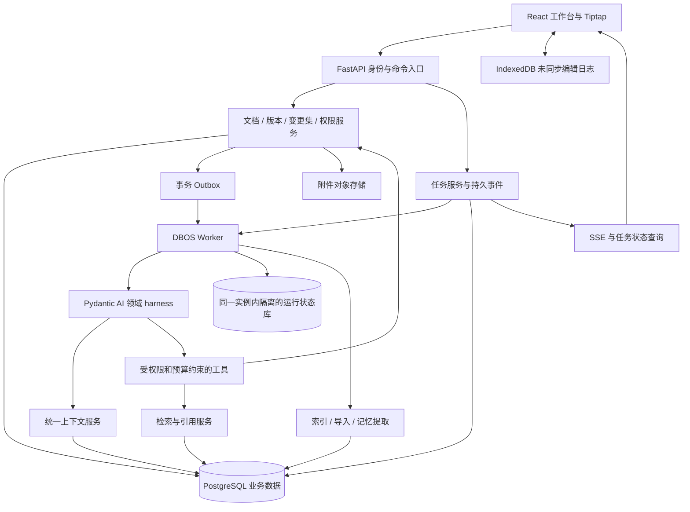

# NoteFlow 从零架构设计与技术选型调研

日期：2026-10-25（Asia/Shanghai）。仓库审查基线：`e80ed54`；交付前补充阅读 `7e8f1a6` 新记录的提示词生命周期问题 AI-16。

状态：**研究与设计提案，未实施、未做候选框架运行 PoC**。用户允许放弃此前整体架构；本文不沿用旧说明书中的“已确定选型”作为约束，也不把此次讨论视为重写和数据迁移指令。官方文档证明组件提供相应能力，不证明它们在 NoteFlow 中已经兼容、达到性能目标或比现状更快。

## 1. 我会做的产品与架构决策

我会把 NoteFlow 定义为：**以个人资料和笔记为基础，能持续完成检索、理解、写作和整理任务，并把成果可靠交回用户的知识工作台。**

用户保存的是长期资产，AI 的回答、草稿和任务是围绕资产发生的工作。系统应同时回答：资料在哪里、结论依据什么、现在进行到哪里、将修改什么、失败后保留了什么。

从零首选：**React / TypeScript + Tiptap；Python / FastAPI + Pydantic AI；DBOS 持久执行；PostgreSQL + pgvector；对象存储；模块化单体，API 与 Worker 分进程。** AI 采用领域工具构成的 harness，第一版不引入完整通用 coding agent，也不同时堆叠 LangGraph、LlamaIndex、Mem0。

这与旧方案的主要区别，不只在换掉三个包：

1. 用“文档版本 + 变更集”统一新建草稿、局部修改、批量整理与撤销。
2. 用独立 Task 表达用户目标；聊天消息、SDK run、执行重试都挂在 Task 上。
3. 自然语言进入一个受限的工具循环，不要求先穷举所有主意图再映射到不同业务图。
4. 可靠性交给一个持久执行层，产品语义由业务服务拥有。
5. 记忆、检索和执行记录都围绕业务数据建立，没有独立于权限与删除规则的第二套资产库。

部分底层选型与现有系统相同，是重新比较后的结果；“从零设计”不要求为了不同而换语言或数据库。

## 2. 当前证据与设计假设

已阅读问题汇总，并核对 README、旧规格、架构与评估文档、依赖、正式规划器、图入口、Outbox、正文数据模型和编辑器扩展。现状已经有版本、预览、检查点、混合检索和部分运行记录；不能把这些描述成尚不存在。

| 仓库证据 | 对新设计的约束 |
| --- | --- |
| AI-10 / AI-11：基础称呼未进入上下文，记忆候选被预截断 | 基础偏好精确读取；相关记忆独立检索；权限和有效性先于最终截断 |
| AI-13：任务续接分支与意图协议不连通 | Task 的目标、版本和生命周期必须独立于意图枚举 |
| AI-15：运行记录和前台过程未贯通 | 从第一条任务开始提供可持久查询的过程与结果入口 |
| AI-16：提示词分散内嵌、缺少发布与运行版本关联 | 提示模板独立管理，任务绑定具体版本，发布前跑正式路径评测 |
| UI-30 / UI-32：异步回包及保存调度串篇的历史问题 | 文档 ID、编辑会话 ID、基础版本、请求归属进入协议 |
| UI-41 / UI-42：导出恢复范围与导入成功口径不足 | 区分内容导出、完整恢复；成功必须以服务端提交为准 |
| OPS-01 / OPS-02：低成本自部署、低内存服务器的历史记录 | 避免默认增加多个常驻数据库、索引服务和监控平台 |
| `models/db.py` 正文为文本，Tiptap 扩展包含下划线、高亮、字号等 Markdown 扩展 | 必须明确富文本结构和 Markdown 源文本谁是权威格式 |

以下是本提案的假设，不是用户已经确认的永久需求：以个人使用为主，可能有多个独立账号；中文知识工作；Web 优先；需要断网保护，但暂不要求长时间完全离线运行 AI；允许调用外部模型；不以实时多人协作为第一版卖点。

四个答案会明显改变架构：是否必须直接管理本地 `.md` 文件夹；是否必须全离线 AI；是否第一天就有多人同时编辑；是否主要追求完全托管和最快上线。第 17 节给出对应改选路线，不用这些未定答案阻止本轮设计。

## 3. 按用户工作划分能力

| 工作 | 用户期望 | 系统保证 |
| --- | --- | --- |
| 记录与编辑 | 打开快、输入顺、不会丢 | 本地编辑日志、版本保存、冲突恢复 |
| 找回与理解 | 找得到，能回到原文 | 字面搜索、语义搜索、来源版本、文内定位 |
| 产出 | 从多份资料形成可编辑成果 | 草稿持续保存、引用、修改审阅 |
| 持续工作 | “接着做”“改刚才那个” | 目标与任务归属、暂停、恢复、结果导航 |
| 个性化 | 记住可靠偏好，能修改和忘记 | 来源、作用域、即时纠正、删除屏障 |
| 数据掌控 | 能搬家、备份、恢复 | 开放导出格式、附件清单、恢复验证 |

第一版优先把“写一篇笔记”“根据资料回答”“改写一段并确认”“中断后继续”四条链路做可靠。网页剪藏、PDF / OCR、定期整理、共享空间和开放插件是后续扩展；通用桌面操作、任意 shell、自主对外发布不进入首版工具集。

## 4. 技术栈选择

| 层 | 从零选择 | 理由与代价 |
| --- | --- | --- |
| 前端语言 | TypeScript，严格类型 | 编辑器、浏览器状态和事件协议容易一起约束 |
| 前端应用 | React + Vite SPA | 登录后的高交互工作台优先；不为它默认引入 SSR。以后公开笔记 / 官网可另设渲染入口 |
| 编辑器 | Tiptap / ProseMirror | 文档 schema、选区、事务和扩展适合受控编辑；仍需中文输入、粘贴及大文档实测 |
| 前端状态 | TanStack Query + 小范围 Zustand + IndexedDB | 服务端资源、临时 UI 状态、本地未同步编辑分别归属，避免一份全局 store 管所有东西 |
| 样式 | CSS 变量设计令牌 + Tailwind + 可访问交互原语 | 统一排版、菜单、弹窗、焦点和动效；组件库本身不代替设计与触屏验收 |
| API | Python + FastAPI + Pydantic | 类型化请求、工具 schema、文档处理及 AI 工作共享后端生态；代价是 TS / Python 两套工具链 |
| 数据访问 | SQLAlchemy + Alembic | 显式事务和迁移；API 类型从 OpenAPI 生成，不人工长期维护两套接口定义 |
| Agent | Pydantic AI core + NoteFlow 领域工具 | 采用现成模型 / 工具循环、结构化输出；NoteFlow 实现权限、上下文和产品语义 |
| 持久执行 | DBOS + PostgreSQL | 模型步骤、后台索引和导入任务复用持久执行基础；需要验证流式、副作用、升级和实际资源占用 |
| 主数据库 | PostgreSQL，选受支持且扩展验证通过的稳定版本 | 事务、关系、JSONB、版本、租户权限和检索可以共用一个底座 |
| 向量 | pgvector | 初期避免第二套向量数据库；小规模可先精确检索，再以实际测量决定近似索引 |
| 附件 | 本地开发磁盘适配；生产对象存储适配，如 OSS | PostgreSQL 存元数据、权限、hash，二进制不塞正文；OSS 与 S3 用不同适配器，不假定 API 完全相同 |
| 协议 | REST 命令 / 查询 + SSE 事件 | 笔记操作清楚，任务进度可续接；有实时协作需求时再引入 WebSocket 同步 |
| 认证 | 不透明会话令牌 + 服务端会话表 + HttpOnly Cookie | Web 产品便于撤销和设备管理；暂不引入访问 JWT、刷新 JWT、旧 token 多代兼容体系 |
| 测试 | pytest、Vitest、Playwright、真实 PostgreSQL 集成测试、正式路径 AI 评测 | 事务隔离 / 并发不能靠内存替身代替，模型质量不能靠 schema 合法率代替 |
| 观测 | 业务事件 + OpenTelemetry | 业务进度可长期查询，技术 trace 可采样导出；不强制额外部署一整套监控集群 |
| 部署 | Docker Compose + Caddy；同一后端镜像分 API / Worker 命令 | 先控制进程与服务数量。Caddy 可管理证书与续期，仍需域名、网络和持久化条件验证 |
| 工程 | pnpm、uv 锁文件、CI 构建镜像、依赖扫描、版本化提示与评测集 | 环境可复制；生产不现拉全套依赖编译 |

FastAPI 的 OpenAPI、Pydantic 校验与依赖机制见[官方功能说明](https://fastapi.tiangolo.com/features/)。证书能力与前提见 [Caddy Automatic HTTPS](https://caddyserver.com/docs/automatic-https)。以上取舍是本项目设计判断，不是这些工具优于所有替代品的性能结论。

## 5. Harness 到底放在哪里

这里的 harness 指模型外围的运行系统：模型循环、工具、上下文、权限、状态保存、预算、取消、恢复和观测。它不是数据库的替代品，也不等同于一个命令行 coding agent。

三种常见做法分别适合不同任务：

| 做法 | 适用 | NoteFlow 的采用范围 |
| --- | --- | --- |
| 固定工作流 | 保存、导入、索引、授权、发布等规则明确的操作 | 使用普通业务流程和持久任务 |
| Agent 工具循环 | 检索哪些资料、先读什么、怎样组织回答或草稿 | 作为自然语言工作的主入口 |
| 通用文件 / shell harness | 编程、复杂文件处理、隔离环境中的开放研究 | 未来可挂成专门能力，不给主助手默认开放 |

“使用 harness”与“使用 LangGraph”不是二选一。LangGraph 可以作为 harness 的运行基础；Deep Agents 也提供现成的上下文与工具能力。Anthropic 的长任务实践强调跨轮工作的状态和交接产物，不能只靠一次上下文压缩维持完整任务。[长任务 harness 实践](https://www.anthropic.com/research/effective-harnesses-for-long-running-agents)、[Deep Agents 官方概览](https://docs.langchain.com/oss/python/deepagents/overview)

我选择领域化组合：工具叫 `search_notes`、`read_note`、`propose_changes`，而不是把数据库映射成一堆任意可写文件。生成的草稿可以像文件一样供模型阅读，但它只是工作产物；正式提交仍走业务服务。

Pydantic AI core 已包含类型化 Agent 循环；独立的 Pydantic AI Harness 包还提供更多可组合能力，但其官方版本策略是 0.x，API 可在小版本变化。首版仅采用必要 core 能力，额外包按需评测并锁版本，不把整套 Coder、shell 和自主委派默认装进产品。[Pydantic AI Harness 能力与版本策略](https://pydantic.dev/docs/ai/harness/)

## 6. 候选运行路线比较

| 路线 | 能得到什么 | 代价 / 约束 | 我的判断 |
| --- | --- | --- | --- |
| Pydantic AI + DBOS | 类型化工具循环、结构化输出、延后审批、持久执行 | 两个运行库的适配、流式桥接、工作流升级要验证 | **从零首选候选**；通过第 18 节 PoC 后定版 |
| LangGraph + 精简领域工具 | 图状态、检查点、暂停恢复，已有项目经验可参考 | 图状态与业务状态仍需分清，避免小动作都图化 | 很好的保守备选；若首选 PoC 失败，优先用此路线 |
| TypeScript + AI SDK + WorkflowAgent / 持久执行层 | 前后端单语言、流式 UI 和 schema 复用 | 需验证选定工作流后端的自部署能力；复杂文档处理可能另加 Python | 若团队主要擅长 TS、以 Web 交付速度为先，这是第一备选 |
| Deep Agents | 现成规划、文件上下文、委派、上下文管理 | 默认能力超出笔记域；需收敛工具、权限与状态归属 | 适合后续复杂研究任务；不是默认全量启用 |
| OpenAI Agents SDK | 应用内 Agent 循环、工具与运行集成 | 持久化与业务契约仍需设计；具体 provider 能力需核验 | OpenAI 生态优先时可选，不等同于托管服务 |
| OpenAI Agents API / 托管 harness | 平台管理运行会话、压缩和恢复，降低自管工作 | 平台可用性、数据位置、费用和可迁移性成为硬约束 | 最快构建长任务产品的另一条路线；本提案的自部署假设下不作为业务底座 |

依据：[Pydantic AI 延后工具](https://pydantic.dev/docs/ai/tools-toolsets/deferred-tools/)、[LangGraph 持久化](https://docs.langchain.com/oss/python/langgraph/persistence)、[AI SDK WorkflowAgent](https://ai-sdk.dev/docs/agents/workflow-agent)、[OpenAI 官方运行路线比较](https://developers.openai.com/api/docs/guides/agents)、[OpenAI Agents API](https://developers.openai.com/api/docs/guides/agents-api/overview)。这些来源已实际打开；不是根据框架名称推断能力。没有运行横向 benchmark，不给虚构分数。

全 TypeScript 不因为“AI”就天然不够用。选 Python 的依据是我把中文文档处理、检索实验、记忆评测作为长期主要工作；若这些都交给外部服务，单语言的开发收益可能反超。Go / Rust 不作为首版业务语言，只有真实 profiling 显示某个计算或解析模块是瓶颈时才考虑局部采用。

## 7. 总体结构与职责

一个代码仓库、一个后端应用，按领域分包，API 与 Worker 独立进程以便限流、重启和扩容。运行状态可在同一 PostgreSQL 实例的隔离数据库或 schema，按 DBOS 实际支持配置选择；业务数据与运行引擎数据分别迁移、限权和制定保留策略。

建议包边界为 `identity`、`documents`、`changes`、`tasks`、`knowledge`、`memory`、`agent_runtime`、`integrations`。Router 不写模型规划或事务细节；工具不直接任意操作 ORM；检索返回证据对象而不是拼好的大提示；前端不从聊天文字猜业务状态。

## 8. 正文、版本和变更集

在当前富文本编辑与 AI 精确改写假设下，我会选择**版本化 Tiptap / ProseMirror JSON 作为正文权威格式，Markdown 作为交换格式**。保存 `schema_version`，限制支持的节点和属性，为块分配稳定 ID；全文文本与搜索块是派生数据。Tiptap 官方推荐 JSON 持久化，并提供 UniqueID 扩展；产品仍需定义复制、拆分、合并、撤销时的 ID 规则。[持久化说明](https://tiptap.dev/docs/editor/core-concepts/persistence)、[UniqueID](https://tiptap.dev/docs/editor/extensions/functionality/uniqueid)

采用这个选择，是为了减少一份正文在 Markdown、HTML、编辑树、AI patch 之间反复转换产生的定位歧义。代价是依赖文档 schema，需要迁移和导出兼容；不能保证所有富文本都能无损转成标准 Markdown。导入保留原始文件，无法表达的结构明确报告；备份导出保留 JSON 和附件，普通 Markdown 导出声明扩展与降级规则。若原始 Markdown 字节级保真是核心诉求，则改用 Markdown 主存 + CodeMirror 路线。

建议核心数据模型：

| 对象 | 关键字段与职责 |
| --- | --- |
| Workspace / Membership | `workspace_id`、成员 / 角色；第一版每人一个私有空间即可 |
| Document | 元数据、当前 revision 指针、归属、删除状态 |
| DocumentRevision | 不变正文快照、schema_version、base_revision、作者、来源任务 |
| ChangeSet / ChangeItem | 基础版本、目标块、操作、新内容、校验、审阅状态、提交版本 |
| Conversation / Message | 会话原始消息、来源、关联任务；不是任务状态表 |
| Task | 用户目标、资源范围、当前状态、产物、取消代数、预算 |
| TaskAttempt | 一次执行的 runtime / SDK run ID、父执行、模型 / 提示版本、重试原因 |
| RunEvent | 递增序号、事件类型、任务 / 步骤 / attempt 关联、公开摘要 |
| Profile / MemoryItem | 明确偏好与候选记忆、来源、作用域、有效期、删除版本 |
| KnowledgeChunk / Embedding | 文档 revision、块 ID、提取版本、模型 / 维度；可重建 |
| Asset | 对象键、内容 hash、大小、类型、扫描状态、引用关系 |
| Outbox / CommandReceipt | 跨处理链可靠投递、幂等提交回执 |

不用每个文字块一张独立数据库记录；初期每个 revision 一个 JSONB 快照，检索块另建派生表，按实际大文档成本决定后续优化。事务保存当前指针和新 revision。自动保存可以合并短时间连续编辑的展示记录，保留明确恢复点，避免每个按键造成永久版本膨胀。

AI 统一输出变更集：新建文档是 create 操作，润色是 replace 操作，批量整理是多文档的一组操作。正文中的草稿视图与差异视图共享同一文档模型，不各自维护另一套正文事实。

应用过程是确定性事务：核验用户和空间 → 读取已批准变更集及其 hash → 核验基础版本 → 验证目标块 / 范围 → 写 revision → 更新文档指针 → 写提交回执与 Outbox → 提交。重复点击返回同一回执；审批后修改变更集会使原审批失效。

块 ID 不能解决所有并发问题。段内改写还要携带基础 revision、明确编码的范围、原内容 hash；中文、emoji、跨 mark 选区必须共同测试。第一版遇到基础版本变化返回冲突并保留双方，不依赖模型模糊匹配后覆盖。后续可对无重叠块安全重定位，对同块冲突仍重新审阅。恢复历史版本也创建一个新 revision。

## 9. 任务运行、工具与人机协作

一个 Conversation 可有多个 Task，一个 Task 可跨多轮消息并有多个 TaskAttempt。业务 Task ID 不等于框架 run ID；暂停后框架可能启动一个新 run，但用户仍是在做同一件事。

任务状态建议为 `queued / running / waiting_user / waiting_approval / completed / failed / cancelled`。`cancel_requested` 是独立请求标志，不能在外部调用仍运行时宣称所有工作已停止。产物也有独立状态：生成完成不等于正式笔记已保存。

UI 中的明确动作，如“应用修改”“停止任务”，直接调用类型化命令。自然语言交给模型选择领域工具，第一版可控制在以下范围：读取指定笔记、搜索授权资料、读取任务、创建 / 修订变更集、请求澄清、提出偏好变更。取消 / 续接工具必须绑定已核验的任务，不按相似话题猜目标。

每个工具拥有输入 schema、权限范围、副作用级别、超时、预算、幂等键、返回结构和审计事件。模型可以建议下一步；能否执行、是否需要确认、结果是否已提交由服务端决定。按钮和自然语言操作必须共享这些规则。

例如“把上周三篇笔记整理成方案，再把第二节写短一点”：

1. 建立任务并明确资料范围；读少量基础偏好和活动任务。
2. Agent 搜索、读取必要原文并提出第一版草稿，保存来源 revision。
3. 用户追加要求，新的消息绑定同一 Task 和产物版本，生成第二节变更。
4. 用户查看稿件与差异；确认后业务事务写正式笔记。
5. 刷新页面后，从任务表和事件恢复真实状态与产物入口。

使用单个主 Agent 起步。复杂独立资料对照可以后续增加只读研究子任务；并行产物由主任务合并为一个变更集，多 Agent 不直接竞争写正式笔记。

## 10. 持久执行的真实边界

DBOS 的价值是复用数据库保存执行进度和调度任务。但恢复不是“所有效果严格只发生一次”。模型请求可能在完成后、检查点落库前断开，外部费用可能重复；业务写入必须另有幂等键、唯一约束和事务回执，外部未知结果要核对或人工处理。非确定性 I/O 必须放入 step。[DBOS 工作流](https://docs.dbos.dev/python/tutorials/workflow-tutorial)、[Steps](https://docs.dbos.dev/python/tutorials/step-tutorial)

已查到的 Pydantic AI / DBOS 适配约束是：需要在持久 workflow 中调用 Agent；自定义工具 I/O 要显式包成 step；普通流式接口在 workflow 内可能缓冲模型事件，实时增量需经 durability 事件处理器桥接，处理器的副作用也要幂等。**这是一项必须运行验证的集成工作。**[官方 DBOS 集成与流式说明](https://pydantic.dev/docs/ai/capabilities/durable_execution/dbos/)

本方案的补充设计：

- 业务命令先在一个事务内写 Task / Outbox；投递器按固定 workflow ID 幂等入队，避免“业务提交了，任务却没入队”。Outbox 只做可靠交接，不再自研第二个完整调度器。
- 等用户确认时持久保存待审对象并结束本次执行；批准后用新的 attempt 继续，不保持长时间占用的 HTTP 请求。
- 所有写工具提交前检查 Task 的取消代数、状态和授权版本；迟到的模型结果只保留为停止时的产物，不自动落正式正文。
- 真实进度事件持久化，带 `task_id / attempt_id / step_id / event_id / seq`；SSE 以游标重连，游标过旧时返回快照。
- 逐 token 文本可合并批次写入产物快照；中断可能损失未确认的末尾增量，界面明确保留到哪里。重试使用新 attempt，替换对应未完成输出，不把两次生成拼在一起。
- `completed` 事件在结果提交后产生；客户端断流不等于任务取消，客户端收到文字不等于正式保存。
- 大文件与长正文用业务资源引用，不直接塞进运行检查点；清理业务数据时同时处理检查点中可能残留的副本。

工作流升级需保留版本：旧任务由兼容版本排空或通过受测迁移继续，不能直接删旧代码后期待检查点自动适配。[DBOS 升级与版本说明](https://docs.dbos.dev/python/tutorials/upgrading-workflows)

## 11. 上下文和记忆

统一 ContextService 返回来源清晰的结构，而不是各个入口自己拼 prompt。包含当前请求、已核验资源范围、当前文档 / 选区快照、活动任务、近期原始消息、摘要、基础偏好和检索证据；每项有来源、版本和可用状态。

| 信息 | 建议策略 |
| --- | --- |
| 称呼、语言、表达偏好 | 开关允许时精确读取少量明确字段；名字与偏好称呼分开 |
| 当前任务目标、进度、产物 | 业务表确定性读取，不依赖向量相似度 |
| 最近对话 | 原始消息为准；摘要记录覆盖范围和版本，可重建 |
| 项目背景 / 经历 | 按 workspace / project、有效状态与时效检索 |
| 笔记知识 | 文档及版本化检索证据；不能与个人偏好混同为事实来源 |
| 隐式长期记忆 | 回答之后异步提出候选，带原始用户来源，经策略决定是否生效 |

第一版不接 Mem0：常用偏好关系字段就能解决，相关记忆用同一 PostgreSQL / pgvector 检索。省去额外的派生记忆同步生命周期，但记忆纠错、冲突与删除策略仍需自己实现。未来只有真实评测证明收益才引入第三方记忆引擎，并让它继续作为可替换索引或提取器。

“记住这件事”在主库提交后才确认，下一轮立即可读；隐式提取不能阻塞回答结束。删除 / 关闭提升 `memory_epoch`，旧任务写回必须校验屏障；从原文、摘要、缓存、检索、任务检查点到备份保留期都有明确删除策略。忘记偏好与删除原聊天是不同操作，要在产品里说清楚，不能删除一行却继续从旧摘要偷偷恢复。

## 12. 搜索、RAG 与知识组织

搜索是独立产品能力，Agent 只是它的调用者。用户直接搜标题需要低延迟和确定的命中；资料问答需要语义、上下文和引用，两者可复用索引但不必使用相同排序。

推荐首版流水线：权限 / 范围 → 标题与词项召回、向量召回 → RRF 融合 → 按需重排 → 读取命中上下文 → 引用校验。当前文档和选区优先直接读取请求绑定的版本 / 未保存快照，不能等待异步向量索引才知道用户眼前是什么。

中文词项搜索需明确分词与术语策略：Python 分词后生成 `simple` 配置词项供 PostgreSQL GIN 检索，加入标题精确 / 前缀匹配，使用中文、英文、代码符号混合语料测效果。`ts_rank` / `ts_rank_cd` 不叫 BM25；只有评测确有增益时再选择 BM25 实现或独立搜索引擎。[PostgreSQL 全文检索机制](https://www.postgresql.org/docs/current/textsearch-intro.html)

每个索引包含 document revision、块 ID、parser / chunker 版本、embedding 模型与维度。新索引完成且基础版本仍匹配时切换可见指针；切 embedding 模型需新建对应索引代际，不混用不同向量空间。

小数据先测权限过滤后的精确向量查询；引入 HNSW 时检查带 workspace / 删除 / 版本过滤的召回。pgvector 官方明确提醒近似索引在扫描后过滤可能不足 K 条，需调参或迭代扫描等策略，不能把 SQL 带 WHERE 当作召回一定充分。[pgvector 过滤说明](https://github.com/pgvector/pgvector#filtering)

引用固定到 revision 与块，重新查看时仍检查权限；原文已删除或用户失去权限就不给旧缓存正文。界面可说明引用来自旧版本。没有依据时明确不足，不用生成的文字替代证据。

第一版不需要 LlamaIndex 的总框架，也不需要图数据库：NoteFlow 自身拥有不复杂的检索管线；双向链接和明确项目关系先用关系表。只有多格式连接器、复杂检索编排或带时间的多跳关系成为主要需求时，再分别评测这些组件。材料进库顺序为“安全接收 → 原件保留 → 解析 → 用户可检查 → 建索引”，解析失败不伪装成空文档。

## 13. 模型、预算与可解释过程

架构采用 ModelProvider 接口，但不承诺各家能力完全等价。先为当前可用的 DeepSeek 接口做基准，再与用户可用的候选模型对照；聊天、工具调用、结构化输出、中文改写、长文一致性分别评测。模型 ID、参数、工具版本与提示版本固定在每次 attempt 中，不以“最新 / 最强”当质量证明。

Pydantic AI 已提供 DeepSeek 适配文档，同时也记录特定推理模式与工具 / 结构化输出组合的限制，因此接口名称兼容不等于行为兼容。[DeepSeek provider 文档](https://pydantic.dev/docs/ai/models/deepseek/)

模型配置可按角色分为 interactive、writer、extractor、embedding、reranker，但第一版不必有五个服务。提取和索引异步，简单聊天不强行多走一次 Planner；复杂任务才显式规划。具备足够质量的同一模型可承担多个角色。

预算在 Task / 账号 / 全局三个层面控制：轮数、工具次数、tokens、并发、超时、容量与费用上限。调用前预留预算，结束后按可获得的实际用量结算；未知费用保守记录，重试算入预算。只对瞬时错误有限重试，验证失败、权限失败和版本冲突不无限重试。

每条回复都能展开“执行过程”：读了哪类上下文、查了哪些资料、工具是否成功、耗时、重试、降级、费用是实测还是估算、结果保存在哪里。用户看到的是可核验动作与简短解释，不是模型内部思维链。普通日志默认不存完整正文与私人记忆；业务事件和技术 trace 分开保留，观测故障不能悄悄改变任务成败。

提示词也应作为正式产品资产：模板文本与例子放独立版本化资源，变量声明和工具 / 输出 schema 建立契约；权限、版本校验、预算与允许写入范围继续在代码中强制执行。运行开始解析发布标签并固定具体模板版本及 hash，中途重试不悄悄切到新提示。

需要可视化改词、对照评测和追踪时，我会接 Langfuse 管理模板与发布标签，避免再造提示词后台；官方支持版本、环境标签和回退。部署条件尚未确认时先用受 Git 管理的模板目录，统一 PromptRepository 接口；平台故障可退到受测的本地固定版本并记录来源。自托管资源和上传内容范围另行核验，不把新平台变成笔记保存的依赖。[Langfuse 提示词管理](https://langfuse.com/docs/prompt-management/overview)、[版本与发布](https://langfuse.com/docs/prompt-management/features/prompt-version-control)

可复用的“技能”由版本化说明、允许的工具集合、输入 / 输出和验收样例组成，按任务加载。文档中的任意指令不能自动安装技能或扩大权限。提示、技能、模型配置与回归数据一起评审，变更先在 staging 评测，再灰度发布。

## 14. 离线、权限和数据恢复

Web 首版采用**服务器权威 + 本地编辑日志**：输入立即写 IndexedDB，服务端同步带基础版本和幂等键。UI 明确“已保存在本机 / 正在同步 / 已同步 / 冲突”，切笔记不复用错误的保存调度；账号切换按空间隔离缓存。断网可以继续修改已缓存内容，AI 任务显示离线状态，不假装已经发起。

如果实时协作成为主需求，则从项目起点选 Yjs / CRDT 权威更新流；JSON 成为快照 / 导出投影。不能同时把 Yjs 状态和可独立覆盖的 JSON 当成两个权威源。CRDT 处理操作合并，不替代 AI 修改审批与语义冲突判断。[Yjs 文档](https://docs.yjs.dev/)、[Tiptap 对 Yjs 持久化的说明](https://tiptap.dev/docs/guides/output-json-html)

安全实现围绕已有实际问题设计：服务端会话可撤销；邮箱所有权先验证；所有修改接口检查 CSRF / Origin；tenant / workspace 范围进入数据库访问、文件访问、检索和任务恢复；模型提供的 ID 与前端传来的审批都重新核验。

PostgreSQL RLS 可作为纵深防线，服务使用非 owner、无 BYPASSRLS 的应用角色，在事务内设置租户上下文并测试连接池复用；RLS 不代替业务授权，运行队列与管理员通道需独立最小权限。[PostgreSQL RLS 规则与绕过边界](https://www.postgresql.org/docs/current/ddl-rowsecurity.html)

工具把文档 / 网页视为数据，不从其中提升权限。附件做流式大小限制、实际类型验证、私有下载鉴权或短时授权；导入限制实际解压量、层级、路径和时长。外部网页抓取单独限制网络目的地、重定向与解析环境，不能让抓取工具访问内网或主机凭据。

两类导出分开提供：Markdown / HTML 内容导出便于阅读迁移；完整恢复包包含文档结构、元数据、版本、任务 / 会话范围声明、记忆、附件实体、manifest、格式版本和 checksums。账号密码和服务密钥不混入普通导出。后台灾备覆盖 PostgreSQL、对象存储和可恢复运行状态，恢复前隔离 Worker，避免旧任务对外重复执行。

初始灾备目标可定 RPO ≤ 24 小时、RTO ≤ 4 小时，均为待验证目标；若可接受的数据损失更小，再采用更频繁备份与 WAL / PITR。任何完整备份承诺必须经过空环境恢复演练。

## 15. 部署、成本与扩容

首版自部署结构是 Caddy、API、Worker、PostgreSQL；对象存储可托管，开发使用磁盘适配。Redis 暂不必需：持久任务由 DBOS 提供，低吞吐配额可用 PostgreSQL 事务计数；若限流写压力或缓存确有需求再加入。首次不部署 Elasticsearch、Neo4j、独立向量库、Kubernetes 和完整监控集群。

沿用低配预算时，首先限制 Worker 并发、后台批次、连接池和检查点保留，构建在开发机 / CI 完成。历史 2C2G 不能当作足够运行新栈的证据，不建议本轮直接购买更贵机器；先跑同机内存、冷启动、索引峰值、AI 并发和恢复测试，再决定是否扩大资源或托管数据库。

CI 产出固定镜像与锁定依赖，单次发布任务负责迁移，应用副本不各自抢跑迁移。服务具备进程退出重启、readiness / liveness、日志轮转、磁盘容量告警和可回滚镜像。公共 health 只报最小状态，详细诊断限运维访问。

扩容按证据触发：API 连接压力大就扩 API，解析与索引耗时长就扩 Worker，搜索测量不满足目标才拆搜索服务；跨团队维护与独立发布需求明确后才拆微服务。数据库拆分前先处理慢查询、批次、缓存和索引，不按用户数量拍脑袋定技术阈值。

## 16. 前端工作台也需要架构

保留“资料导航、工作内容、助手”这三个工作对象，不要求永久三栏。桌面允许并排，窄屏按活动切换；主区域可以阅读、编辑、审阅同一产物。用户从聊天中的任务卡能直接回到对应稿件或正式笔记。

编辑器拥有输入状态；Query cache 拥有服务端资源；Task 订阅拥有运行状态；Zustand 只存当前选择、面板开合等 UI 状态。每个异步回包带资源 ID 和版本，不能依赖“当前打开的是哪篇”判断写回位置。

菜单、对话框、移动抽屉统一焦点、Escape 层级、输入法组合和滚动规则。进度、错误、空、未加载、取消、冲突分别建模，避免把初始空数组显示成“0 条”，或把本地导入开始显示成“导入成功”。视觉设计系统与这些状态契约一起交付。

## 17. 什么情况下改选其他架构

| 优先目标发生变化 | 我会怎样改选 | 必须接受的代价 |
| --- | --- | --- |
| 类似 Obsidian，直接管理本地 Markdown 文件夹 | Tauri + TypeScript / CodeMirror + 本地 SQLite；Python 处理作为可选服务，云同步另设计 | 文件监视、冲突、附件路径、签名更新；云端 AI 读取需显式同步或授权 |
| 完全离线、资料不出设备 | 本地 SQLite / 本地索引 + 可用本地推理服务 | 设备性能、模型质量、包体、模型升级与电量限制；不承诺低配设备长任务能力 |
| 多人同时编辑是首要场景 | Tiptap + Yjs、协作连接服务、明确 CRDT 权威存储 | 权限撤销、更新清理、版本恢复、审阅与合并的设计成本前移 |
| 全团队只熟悉 TypeScript，主要处理网页文字 | React + Fastify + AI SDK + 经验证的 durable runtime + PostgreSQL | 中文解析 / OCR 库需单独评估；不能用普通内存循环冒充可靠长任务 |
| 主要追求最快提供强 Agent，接受平台依赖 | 托管 harness + NoteFlow 领域 API / 受限工具 | 需要验证账号地区可用性、数据控制、使用成本、平台故障与退出迁移 |

这些是不同产品假设下的方案，不是要把五条路线同时实现。当前我建议选择云端知识工作台路线，把文件优先、完整 CRDT 和通用执行沙箱放到明确需求出现时再决定。

## 18. 从设计到可信结论的验证顺序

本轮只完成研究。实施时先做一条纵向 PoC：**打开资料 → Agent 读取 → 生成变更集 → 用户修改原文 → 冲突保护 → 审阅提交 → 中断重启 → 继续查看任务与结果。** 这条链路同时验证运行框架、正文模型、持久执行和体验，不先迁移所有模块。

| 阶段 | 要验证的结论 | 通过条件与后续决策 |
| --- | --- | --- |
| A. 文档模型 | JSON / 块 ID 能否覆盖真实内容 | 中文 IME、emoji、表格、代码、嵌套列表、mark、粘贴、导入导出、历史语料对照；不支持项有保真保留和提示 |
| B. Agent / durable PoC | Pydantic AI + DBOS 是否适合本项目 | 真实 provider 的工具、结构输出、实时事件；模型中断、工具提交后断电、审批后重启、取消竞态、升级恢复；零越权、零重复业务提交 |
| C. 中文任务评测 | 新循环是否优于旧入口 | 问候偏好、检索、选区改写、指代、继续 / 取消 / 切换、注入文档；对照成功率、误操作、澄清、延迟和成本 |
| D. 检索与记忆 | 质量与删除一致性 | 标题 / 术语 / 中文 / 代码检索、来源有效性、无依据回答、跨账号拒绝、删除后的摘要与旧任务不能复活记忆 |
| E. 数据与部署 | 新方案能否真正运行和恢复 | 导出导入往返、空实例恢复、附件 hash、迁移回滚方案、低配峰值、Worker 重启、实际 HTTPS 与邮件链路 |

建议初始体验预算：输入反馈 p95 ≤ 50ms、缓存笔记打开 p95 ≤ 200ms、已鉴权任务受理反馈 p95 ≤ 500ms；这些是实验目标，测试须说明设备、网络、文档规模和并发。模型首字、全文完成与最终保存分开计时，不拿 provider 首字冒充端到端延迟。质量用成功完成具体工作衡量，不能只测工具 schema 合法率。

若 B 不通过，不继续堆补丁证明选型正确：以相同文档 / Task / ChangeSet 接口换用精简 LangGraph runtime，重新跑同一组验收。若只是现有系统修复而非新建项目，先修已有安全和数据可靠性问题，不能等架构重写完成再处理。

真正迁移时保留用户 ID、文档 ID、原始正文、附件引用和可回滚快照；新旧运行链按空间或任务灰度，单篇文档只允许一个写入权威。迁移到结构化正文先做影子转换和人工抽样，未通过的文档继续旧格式读取，不静默丢内容。只有新链路通过目标环境验收后，才删除旧运行分支和依赖。

## 19. 本轮交付与未完成项

本轮新增本文与文档导航，给既有问题补充提案关联；不修改前后端产品、依赖、数据库、服务配置、模型或用户数据。执行文档内部链接、差异和空白检查；没有跑未改动产品的构建，也没有声称任何候选已完成兼容或性能测试。

未完成：产品关键假设确认、候选 SDK 锁版本与许可证 / 扩展清单核验、实际 PoC、真实模型对照、结构化正文历史兼容、流式与持久化集成、目标机器容量及恢复演练。既有问题状态不因本文而提高。后续实际实施以单独任务与验收结果更新本提案。
