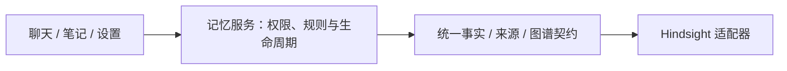

# 记忆引擎字段隔离与生命周期契约

日期：2026-10-31。实施范围：记忆引擎结果、状态、来源与图谱的归一化，现有消费者和界面的调用契约，以及旧 Mem0 索引的结果转换。当前部署继续使用 Hindsight；没有新增数据库迁移、批量导入或清理用户记忆。

## 1. 现在怎么分工

- [engine.py](../../server/app/memory/engine.py) 定义 `MemoryFact`、`MemoryChanges`、`MemoryDocument` 和 `MemoryGraph`，不导入具体提供商。事实包含项目统一的 `content / source_id / status / derived` 等字段；列表过滤明确使用 source_id / status，不接受任意厂商过滤字典。
- [Hindsight 适配器](../../server/app/providers/hindsight.py) 独自处理 text、document_id、fact_type、valid / invalidated、图谱 data 包装、原生连线名称及来源 original_text。更新内容与状态也由 MemoryChanges 转为厂商请求；未知状态为 unavailable，畸形数据返回安全错误，不默认当作有效记忆。
- [Gateway](../../server/app/memory/gateway.py) 只认识上述对象和本项目的来源 / 账号规则。它不根据引擎品牌决定如何处理事实。正式事实的类型转换、测试库、读写、修订、待确认、重复项、来源删除与图谱过滤均经过这一边界。
- [注册入口](../../server/app/providers/memory_registry.py) 根据部署配置选择适配器，默认注册 Hindsight。未知配置明确失败。`uses_engine` 区分正式事实引擎与旧的本地事实 / 索引兼容模式，账号旧 opt-in 值仍不参与选择。

正式事实引擎与旧 Mem0 索引承担不同的数据职责：前者保存正式事实和来源，后者只给 NoteFlow 本地事实排序。本轮没有把二者强行伪装成同一种存储。旧索引协议增加 `MemoryIndexHit / MemoryIndexWrite`，Mem0 的 SDK 字典、嵌套 metadata 和 ADD 等事件值在其适配器转换；runtime / outbox 消费统一的关联 ID 和写入结果。旧数据库字段、已有外部 ID、回填工具和诊断指标名称保留，避免改变存量数据归属。

## 2. 生命周期由谁决定

| 情况 | 引擎统一结果 | NoteFlow 的处理 |
| --- | --- | --- |
| 已发布、正常事实 | active | 来源有效、开关允许且符合内容 / 范围规则时可用于回答 |
| 用户停用 | archived | 管理列表仍可查看；回答和图谱排除，可恢复 |
| 修订保护下的自动新事实 | archived | 来源控制标记为 pending，用户确认后才恢复 active |
| 完全重复项 | archived | 来源控制标记为隐藏，不重复展示 / 召回 |
| 引擎未知状态 | unavailable | 不进入列表 / 回答 / 图谱，不推断为 active |
| 派生推测 | derived=true | 当前版本排除，与原生 world / experience / observation 名称解耦 |
| 用户彻底删除来源 | 引擎删除可能尚未完成 | 先提交项目来源删除屏障，再清理引擎；失败保留重试，旧来源不可复活 |
| 关闭或修改规则后执行旧队列 | 无须调用引擎 | 校验开关、代数和规则版本，不匹配即跳过旧任务 |

本轮保留既有的账号级人工修订保护策略，未改变来源状态、队列状态、规则版本或关闭 / 删除屏障。后续是否将全面待确认改为仅冲突项确认，需要独立的产品决策与质量评测。

## 3. 界面只读功能和业务字段

- `/api/memory-console` 增加 capabilities，界面按 rules / graph / importLegacy 等能力显示入口，engine 名称仅作诊断信息。
- 来源返回 `document: {id, content}`；图谱返回节点 `{id, content, sourceRef}` 和连线 `{source, target, relation}`。这些是项目接口，不直接透传厂商对象。
- 图谱文字与来源取自当前有效事实，排除跨来源、待确认、停用与隐藏节点及相关边；不能由引擎图谱里的旧标签覆盖手工修订。
- 设置中的来源删除确认按 sourceRef 判断，与 provider 名称无关；原来的整来源影响确认继续保留。
- 前端读取能力时处理缺失值，混合版本 / 不完整响应不会因访问 capabilities 抛错。前后端应配套发布并刷新旧页面，避免旧客户端继续依赖已归一化的图谱 / 来源字段。缺失能力时不开放相应新操作。

没有改变记忆页面的布局、颜色或操作顺序，也没有增加引擎切换按钮或第二套管理平台。

## 4. 验证证据

1. **后端全量发现测试**：`PYTHONDONTWRITEBYTECODE=1 NOTEFLOW_RUN_DB_TESTS=0 node scripts/run-python.mjs -m unittest discover -s server/tests -p 'test_*.py'`，运行 270 项，其中 262 通过、8 项按既有门槛跳过。
2. **另一种引擎契约验证**：[test_memory_engine_boundary.py](../../server/tests/test_memory_engine_boundary.py) 用原生 body / origin / enabled 字段的内存参考引擎，通过实际注册入口和真实 Gateway / MemoryService / MemoryContextService / 部分管理接口执行。SQLite 内存库验证账号隔离、当前状态过滤、人工修订后的待确认、重复项隐藏、删除失败屏障、旧队列跳过、图谱与来源过滤、隔离试运行和错误配置。账号锁使用替身，不代替 PostgreSQL 锁验收；参考引擎不是生产适配器。
3. **适配器测试**：Hindsight 字段 / 过滤 / 状态 / 日期 / 图谱 / 来源归一化、分页、未知状态、缺失库和安全错误；Mem0 SDK 过滤与事件转换、旧 outbox 写回、受限召回及回落均通过。Hindsight 使用 MockTransport，Mem0 使用 SDK 替身。
4. **真实 Hindsight + PostgreSQL + 正式 ASGI**：`memory_hindsight_e2e.py` 的 23 个场景通过，覆盖中文抽取 / 召回、账号隔离、来源、人工修订 / 停用 / 恢复、规则版本、图谱、来源删除与重放、开关 / 旧队列、待确认，以及隔离库备份恢复。合成账号与演练库已清理。
5. **前端构建和组件**：`npm run build`、`test:frontend`（47 组组件 / 10 项 store）与 `test:memory-settings`（8 项）通过。删除确认使用 provider=reference / sourceRef 的合成事实验证，证明不再依赖 Hindsight 品牌判断。
6. **隔离浏览器**：`memory-console-browser-test.mjs` 在 736 / 320px 通过规则、试运行、历史、图谱键盘、来源和导入操作；fixture 的 engine=reference，所有实际网络阻断。另测没有 capabilities 时仍能安全刷新；无 pageerror / 横向溢出，截图人工检查。
7. **已加载的开发 API**：优雅重启本机开发后端前，只读确认没有近期 AI / 草稿生成及正在处理的队列；保留前端和旧容器。实际 HTTP 合成会话验证自动记忆、后台 worker、统一上下文、capabilities 及归一化来源 / 图谱通过，随后清理合成账号与事实。`check:dev-ports` 确认前端 5173 对应 API 8082。

初次组件回归的旧替身只返回空对象，暴露缺失 capabilities 时界面会抛错。已补缺失值保护，并按正式接口更新 fixture；最终组件和浏览器回归均通过，不将初次失败计为通过。Node 模块注册、Python UTC 弃用和前端大块打包告警保留，本轮未处理依赖或性能。

## 5. 尚未完成的范围

- 生产目前只注册了 Hindsight 正式事实引擎；参考实现证明调用边界与治理语义能够独立运行，不代表 Mem0 / 其他产品已具备同等来源、图谱和删除能力。
- 更换真实引擎仍需实现适配器，并验证历史事实、关联 ID、规则、人工修订、停用 / 删除与备份的迁移语义。本轮未做引擎切换或用户历史数据迁移。
- 本轮 HTTP 检查没有再次停止真实 Hindsight；可选记忆故障的隔离图测试通过，沿用原有真实停机演练证据，不把旧证据标成本轮新演练。
- 长期语义质量、复杂矛盾、生产容量、完整生产恢复及以前记录的普通笔记并发 / 附件一致性问题仍未闭环。

AI-18 继续标记部分解决；本轮完成的是厂商结果 / 状态不进入治理和界面的子项，并有上述运行证据。代码与接口应整体回退；不存在需要回滚的数据迁移。
