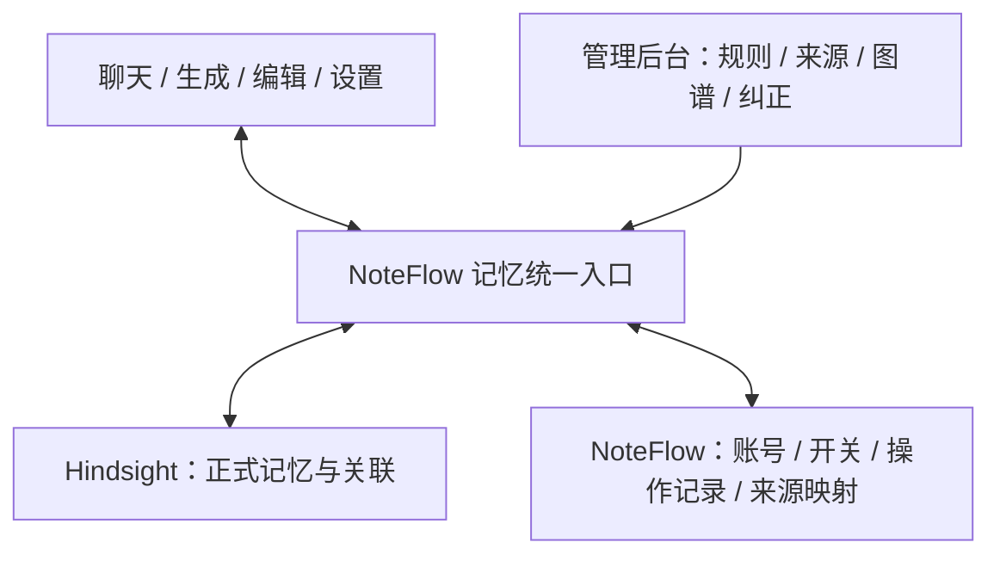

# NoteFlow 记忆系统第一版：设计与验收

日期：2026-10-31。状态：本机 Hindsight 新路径已接入，新旧账号自动接入，旧记录可预览导入；实际能力、23 项真实服务验收与生产边界见[实现与验收记录](memory-v1-implementation-2026-10-31.md)。以下设计中的规模、生产与全量迁移门槛仍需相应环境验收。

用户的目标是模块解耦、可自己配置记忆要求、可查看来源和关系图谱，并且不购买记忆平台订阅。选用 Hindsight 开源自建服务及其管理后台；模型调用、机器资源与软件订阅分别核算。具体部署版本、模型兼容和后台能力必须在本机验证后固定，不能把最新云平台文档直接当作当前自建版本的能力。

## 1. 第一版必须交付的体验

用户正常聊天，明确的长期信息能够被整理；下次相关问题能用上；设置页与后台可以查看同一条记忆、追溯来源、纠正或停止使用；后台可以调整抽取要求和查看图谱。

第一版必须同时满足账号隔离、关闭后不再读写、明确保存失败不假报成功、任务流水不自动成为长期记忆。重复、矛盾、过时记忆的基本处理也属于第一版；后续阶段只进一步提高质量，不把这些基本正确性延后。

## 2. 职责和唯一正式来源

| 部分 | 负责 | 边界 |
| --- | --- | --- |
| 笔记系统 | 笔记正文、版本、知识库检索 | 笔记中的人物、示例和知识点不能自动当作用户事实 |
| 任务系统 | 当前进度、完成、取消、失败、任务续接 | 默认只保存任务记录；真正的个人经历仍可通过记忆入口进入 |
| NoteFlow 记忆入口 | 服务端账号、允许来源、读写开关、任务提交、操作状态、来源映射 | 业务模块只使用统一结果，不依赖厂商 SDK、私有 ID 或 ORM 对象 |
| Hindsight | 正式事实、来源文档、关联、整理与检索 | 第一版正式记忆以该服务中的状态为准 |
| 管理后台 | 修改抽取配置、检查来源与检索、图谱、纠正事实 | 运营者工具；修改操作也必须经过治理入口，不给普通用户暴露整个实例的管理员入口 |

**关键修订：不把当前的双份记录模式原样搬过去。** 现有 `UserMemory` + Mem0 是 NoteFlow 保存正文、向引擎同步索引的模式。若在 Hindsight 后台直接编辑引擎事实，同时仍从旧 `UserMemory` 回填，两个界面会不一致，删除还可能被旧任务覆盖。

目标模式中，Hindsight 保存正式记忆内容；NoteFlow 保存账号、开关、来源映射、待处理操作和必要的删除/重试屏障。NoteFlow 设置页通过统一入口读取同一份事实。旧 UserMemory 作为迁移来源保留，切换后的读取不能在引擎为空或故障时偷偷回落到旧记忆正文。后台编辑或停用的结果也必须被后续读取尊重。

这项决策替代之前“后台可自由编辑，但 NoteFlow 主库同时维护另一套正式事实”的含糊方案。Mem0 原路径仅作为运维兼容模式保留；引擎由系统统一配置，用户无需点击启用。一次部署只允许一个活动引擎写入。

**后台不能绕过治理。** 唯一数据源只解决两份事实不一致，还不能阻止运行中的任务在后台删除后再次写入。因此后台的删除、修订、规则变更和重处理也必须经过同一操作入口，协调运行任务并记录删除屏障、修订保护和规则版本。固定版本验证时先检查原后台 API 能否通过受控代理接入；必要时只补这些管理动作，不重做图谱。未接通的原生写入口保持禁用，不能把“原生后台已打开”当作管理功能完成。维护者直接调用底层引擎属于停写维护操作，需要核对后再恢复服务。

## 3. 写入、读取和用户控制

### 自动整理

1. 只提交本轮已提交的用户消息及必要、标明来源的上下文。重试回答不产生新的写入身份。
2. 来源由服务端判定。助手生成的内容、引用文章、代码例子和任务状态不直接成为用户自述。
3. Hindsight 负责事实抽取；NoteFlow 配置抽取要求和输入边界。避免 NoteFlow 先抽取一次、Hindsight 再抽取一次，两套规则互相覆盖且重复消耗模型。
4. 自动整理使用持久任务，失败可重试。任务保存 source_id、用户、规则版本及开关/清理代数；执行前后核对状态。关闭、清理或切换后，旧任务不得继续写回。
5. 按用户的记忆变更协调顺序；删除要处理已运行的抽取与后续派生任务。仅在队列入口检查一次开关不够。

### 明确要求记住

区分“已提交整理”“实际保存了哪些事实”和“未提取出长期信息”。用户说“记住”后，只有实际保存成功且结果可读取才能回复已记住；排队或超时必须如实说明。不把一次网络超时当作可以无条件重复创建的新请求。

### 读取

聊天、生成、编辑消费同一份结构化结果，包含事实内容、来源、状态与引擎标识；AI 应用层负责组成提示词。当前明确要求优先于历史偏好，记忆文本作为资料使用。

普通聊天的可选记忆检索失败时，清空该次记忆上下文并继续回答，记录降级原因。用户明确查询/管理记忆时，服务故障要报告“暂时查不到/操作失败”，不能误报“没有记忆”或“删除成功”。不把服务故障、检索无结果、用户关闭混成同一种状态。

### 开关、停用和删除

| 操作 | 用户能理解的结果 |
| --- | --- |
| 关闭记忆 | 停止自动读写，保留已有记录供本人查看和管理；重新开启不补录关闭期间的聊天 |
| 停用某条 | 后续记忆召回不使用，允许恢复；其派生观察也要失效或重新核实 |
| 纠正某条 | 修改同一条事实，后续读取使用修正结果；自动整理不得静默覆盖用户修订 |
| 删除来源及相关记忆 | 显示本次涉及的事实与派生内容；删除成功后不能由旧任务、重建或迁移重新导入 |

Hindsight 的事实失效（invalidate）与来源文档删除具有不同语义。对所选版本逐项实测后映射 UI：不能将可恢复的停用包装成彻底删除。若一个来源包含多条事实，彻底删除来源的影响必须展示。记忆管理与笔记/聊天原文的删除也必须区分；记忆清理不意味着原聊天文字已经消失。

## 4. 用户、项目与规则

第一版先实现独立的个人记忆库，用户身份只来自已认证服务端上下文，不能由模型输出或客户端任意选择 bank_id。为项目级作用域预留结构，首版不自动共享不同用户/项目的记忆。

管理后台面向项目维护者；NoteFlow 用户在应用内只能管理自己的内容。后台的服务凭据留在服务端，开发部署绑定本机。自建版的访问控制能力需按固定版本验证，不能借用云平台付费权限功能的宣传作为验收。

记忆规则配置的是 **Retain 的抽取要求**。Reflect 的回答规则不等于“什么信息会被记住”。初始要求可为：

> 关注用户明确表达的长期偏好、个人背景、持续学习目标与项目决策。忽略临时编辑指令、系统运行日志、任务完成/取消/失败，以及引用材料中的他人信息。事实注明来源和适用范围；不从缺失信息推测用户经历。

每次修改规则应有当前版本与恢复入口；用几条合成示例预览效果后生效。规则默认作用于新内容，旧记录的重处理必须单独发起、展示影响，保护手工修订和已删除内容。预览是否调用模型及其费用应明确。

基本质量规则由应用定义，抽取与匹配可交给引擎执行，但不能假定换一个引擎就自动满足：

- 同一消息重试只处理一次；语义重复尽量合并，并保留来源依据。
- 用户明确纠正时使用新事实、保留变更来源；存在歧义时保留待核实状态，不把相互冲突的事实同时当作确定事实注入回答。
- 临时任务不入长期库；有期限的信息记录适用时间；人工修订不能被旧任务覆盖。
- 项目专属要求不能升级为全局偏好；首版未具备对应范围过滤时不自动用于其他项目。
- 密码、验证码、密钥不进入长期记忆。抽取测试使用合成样本，日志不输出原始敏感内容。

任务设输入长度、超时、有限重试与模型消耗上限，失败后可查看状态并手动重试；避免一段异常长文或服务故障触发无限调用。具体默认值在固定模型的中文测试后确定。

## 5. 后台和图谱的产品范围

复用开源后台的配置、记忆浏览、来源查看、检索调试和图谱。NoteFlow 设置页保持简单：记忆开关、本人记录、来源和修订/停用/删除状态。

图谱是检查关联的视图。共同出现、语义相关、时间关联、推断关系应按真实数据标注，不能把一条连线当作因果事实。用户明确说过的事实与系统推断的观察需要可区分，点击可追溯依据。

## 6. 旧系统迁移与回退

1. 独立部署试验服务和测试记忆库。先用合成对话验证，不自动把全量笔记或真实聊天灌入新服务。
2. 现有 Mem0 用户数据保持原样。生成迁移预览：有效记录、待核实记录、任务流水、用户修订，给出数量和来源依据。
3. `source=work_memory` 与任务关联可帮助识别流水，但必须检查后续编辑；不能按“历史经历”类型全部删除。
4. 迁移清单带源 ID、版本和目标 ID，支持幂等重跑；已删除、停用内容及旧索引任务不得被重新导入。
5. 系统默认接入 Hindsight；旧记录的导入另行预览核对，不让用户选择引擎。切换后有新修改时，回退需要携带修改/删除记录和再核对，不能简单切环境变量而复活旧数据。
6. 备份恢复包含记忆、配置、来源映射、删除记录与操作状态，并用恢复演练确认。

已有 DEV-27 记录本机 Docker 磁盘与资源问题；部署前重新检查当前余量。首版不为了省软件订阅费而忽略机器和模型调用成本，也不以“自建免费”推断本地模型质量达标。

## 7. 第一版验收清单

以下是交付门槛，不是已经通过的测试：

| 场景 | 必须看到的结果 |
| --- | --- |
| “我刚学 Go，解释通俗一点” | 可读到事实、来源；新会话相关回答可以使用 |
| “把这句话改一下”/取消修改 | 任务正常结束，无自动任务流水记忆 |
| 引用文章“我在北京工作” | 不成为当前用户的工作地点 |
| 用户 A/B 同时使用 | 列表、检索、直接 ID 操作都不串账号 |
| 关闭时已有排队/运行任务 | 不继续保存；重启 worker 或重新开启不复活旧任务 |
| 后台修订、应用修订 | 两边与下一次回答一致，用户修订不被旧同步覆盖 |
| 停用/删除后再检索 | 原事实及受影响派生内容不再进入回答；旧任务与迁移不复活 |
| 修改规则 | 新任务使用对应版本；旧记录保持明确的处理状态 |
| 重复提交/超时重试 | 不重复创建；实际结果可查，明确保存不假报成功 |
| 记忆服务停止 | 普通聊天可继续；明确记忆操作报告失败 |
| 图谱点击节点 | 来源可追溯，连线含义可解释 |
| 中文数据与长文 | 测抽取、检索效果、延迟和实际模型消耗，不以厂商榜单代替 |
| 迁移与恢复 | 数量/来源/修订/删除状态对得上，可回退且不复活已删除事实 |

## 8. 实施顺序与当前证据

1. **边界修正与设计**：先阻止任务终态写长期记忆，明确唯一来源、故障处理和验收。
2. **独立服务验证**：锁定开源版本，启动本机后台、验证模型、中文抽取、事实修订/停用/删除及图谱，检查费用和资源。
3. **统一入口接入**：按事实读写、整理任务、管理配置分能力接口，迁移聊天/生成/编辑/设置；测试替身必须可以替换，业务代码不直接导入具体引擎。
4. **完整闭环验证**：跑上面的真实服务及浏览器场景，给用户操作后台。
5. **旧数据迁移**：预览、核对、迁移、切换、回退演练。

这些是第一版内部的实施步骤。第 1 步完成不能称第一版交付，更不能因为有接口文件或部署脚本就称全链路完成。

设计轮证据（实现前）：移除 `routers/agent.py::_resolve_checkpoint_by_id` 的终态自动记忆写入；新增正式函数的行为测试，覆盖三种任务 × 三种终态、重复取消、找不到/不可见检查点，禁止记忆查询与新增并验证任务状态/关联保留。连同原有 Agent 记忆、草稿、写入图和架构测试共 24 项通过，数据库/模型调用均为替身。未重建运行中的后端容器，未访问或迁移真实记忆，尚未部署 Hindsight。

设计轮故障隔离证据（实现前）：真实只读图注入记忆读取超时，修复前返回 failed / memory_read_failed，回答调用为 0。修复后继续正常回答，清空旧记忆上下文，跳过该轮自动记忆写入，只记录不含异常原文的降级追踪；显式记忆管理路径保持原语义。只读图、聊天路由与回答重试测试共 22 项通过，其中新增超时降级 / 无敏感异常泄露、关闭记忆不读写两个用例。本轮合计 46 项测试通过；属于隔离执行证据，不替代真实服务停机、浏览器和生产验证。

实现提交：`1aba272`（任务终态边界）、`c1ef745`（可选召回故障隔离）。问题汇总 AI-18 / AI-19 均保留部分解决状态。

## 9. 参考与相关问题

- [Hindsight 源码与许可](https://github.com/vectorize-io/hindsight)
- [部署方式和资源要求](https://hindsight.vectorize.io/developer/installation)
- [记忆库配置、Retain 与 Reflect 的边界](https://hindsight.vectorize.io/developer/api/memory-banks)
- [事实修订和失效](https://hindsight.vectorize.io/developer/api/memories)
- [来源文档生命周期](https://hindsight.vectorize.io/developer/api/documents)
- [图谱功能](https://hindsight.vectorize.io/blog/2026/04/07/version-0-5-0#constellation-view)
- 仓库问题：AI-06、AI-10、AI-11、AI-14、AI-16、AI-18、AI-19、DEV-27。以上文档描述的是目标能力；具体自建版本仍需验证。
