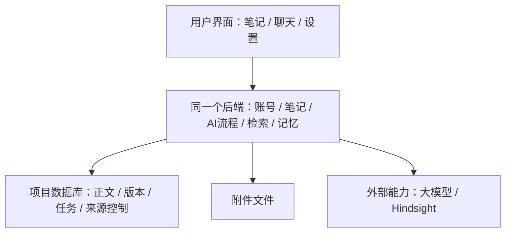

# NoteFlow 现有系统分工与成熟度盘点

日期：2026-10-31。审查基线：`cc9f3e5`。本轮梳理当前源码、既有问题和关键边界测试，仅新增审查文档，没有修改产品行为、依赖、真实业务数据、运行服务或部署。

## 1. 给使用者的结论

系统已有可以继续使用的基础：账号隔离、正式笔记与版本、独立草稿和修改预览、持久任务、检索入口与记忆入口。接下来更值得投入的是保存、权限、失败恢复和模块交接的正确性。

目前适合继续使用现有技术栈与一个后端应用，按职责维护模块。独立部署服务、通用管理平台和更换 Agent 框架，都需要具体问题和验证结果支持。此前从零架构研究属于候选提案，不能当成当前已落地的实现，也不能仅凭提案名称安排重写。

图省略了限流、缓存和各处理步骤。当前 index / draft / outbox worker 由 API 的生命周期启动，在同一应用进程内运行；任务记录持久化，不等于执行中的外部调用可以跨进程退出无缝继续。

## 2. 模块分工、数据归属与当前判断

| 模块 | 应负责什么、哪份数据作准 | 源码观察与成熟度判断 | 当前取舍 |
| --- | --- | --- | --- |
| 界面与编辑器 | 展示、输入、本地未同步修改与反馈；服务端确认前，本地手稿必须保留 | Tiptap 编辑树与 Markdown 互转；Zustand 承接笔记、会话、预览、知识库动作；有按账号 / 笔记的本地日志和离线队列、旧结果隔离。selector 分包有利于订阅，但业务动作仍集中 | 保留现有交互；后续按保存 / 会话 / 预览逐步整理动作入口，防止跨功能状态串扰。文件行数本身不构成重写理由 |
| 账号与权限 | 确认当前用户、会话有效性；由后端把身份传给业务模块 | CurrentUser 校验 Cookie / Bearer 与会话；Repository 主要按 user_id 限定；旧无 sid 凭证、附件链接和诊断权限仍有既有未闭环项 | 复用统一身份入口；优先解决 SEC-02 / SEC-04 / SEC-07，现有鉴权测试不能代替完整安全验收 |
| 正式笔记与版本 | `Note.content` 的 Markdown 是当前服务端正文，`NoteVersion` 是历史快照；章节 / 检索块是派生数据 | 普通保存有预期时间 / 内容 hash 校验与历史快照，但读取、检查、写入未形成原子并发保护（UI-45） | 保留版本和冲突提示；先统一各写入口的并发规则，再考虑正文格式迁移 |
| AI 草稿与修改 | 生成可审阅产物；确认后通过受控写入口变更正式笔记 | 草稿 / 章节和修改预览独立持久化；应用预览对预览与笔记加锁，校验原文 hash，重复应用有回执。LangGraph 授权状态和业务提交分属不同会话，不能视为一个原子提交 | 保留“产物 → 审阅 → 应用”；补跨状态失败窗口验收。AI-05 / AI-13 的任务恢复边界仍需实测 |
| AI 计划与回答 | 判断本轮目标、安排读取、执行领域动作、输出流式状态；不以回答文字充当业务完成凭据 | TurnPlan / LangGraph / AgentRun / Checkpoint / 工具追踪已存在；任务续接协议、contextScope 硬约束、完整追踪和提示版本仍有已知缺口 | 优先补 AI-13 / AI-17；逐步关联 AI-15 / AI-16 的执行与提示版本，现阶段没有依据再换一套运行框架 |
| 检索与索引 | 从本人有效笔记生成可重建索引，返回正文依据；索引不能反过来覆盖原文 | 普通搜索使用 note_library；正式 RAG 使用统一 RagService 与结构化 pipeline；保存同时安排旧章节块和 RAG v2 两类任务，v2 有来源版本屏障 | 两类查询用途应先明确；核对消费者和一致性后再收敛派生数据，不能因名字“旧”就删除仍在使用的路径 |
| 长期记忆 | 应用决定允许保存 / 读取哪些来源、何时失效；Hindsight 保存新路径的正式事实与关系 | 来源控制与规则在项目数据库，事实在 Hindsight；有账号、开关、代数、队列和删除保护。本机接入有证据，厂商字段仍进入治理层，内容质量尚未长期验收 | 保留内部薄服务层；沿用 AI-18 的适配边界与 AI-14 的质量评测缺口，不新建独立管理员平台 |
| 附件、后台任务与运维 | 附件实体和元数据一致；可重试工作持久化；备份能恢复整套数据 | ObjectStorage 与 SQL 元数据分开；文件操作先于数据库提交，故障可产生不一致（UI-46）。Outbox 有领取锁、重试及幂等键；生产服务地址与配对恢复仍需验收 | 先补附件补偿 / 清理和恢复契约；复用现有持久任务机制。按真实负载决定是否把 worker 独立成进程 |

浏览器存储含有尚未同步的有效输入，不能一概当作随时可删的缓存。Hindsight 来源控制与事实也不是两份可互相覆盖的正文副本，两边需按相同备份与生命周期协同恢复。

## 3. 用实际操作核对模块交接

### 编辑一篇笔记

输入 → 按账号 / 笔记保留本地修改 → 客户端按笔记串行发送 → 后端检查版本、写正文 / 历史及索引任务 → 返回保存结果 → 清理已确认的本地修改。

客户端串行可以减少同一页面的竞态，无法协调另一个设备。`routers/notes.py::update_note` 通过普通 `NoteRepository.get` 读取并检查 hash，然后 ORM 更新并提交；此入口没有锁、带预期版本的条件 UPDATE 或 mapper 版本列。两个请求可同时通过同一个基础版本检查。此为已确认的应用层保护缺口，尚未执行 PostgreSQL 并发复现，不能宣称已经发生用户数据丢失。

下一步验收：同一基础版本的两份不同正文并发提交，最多一份成功，另一份明确冲突并保留手稿；另测与 AI 应用、版本恢复、删除交错。并发策略需覆盖相关写入口，避免只在一处加锁。

### AI 修改正文

用户确定范围 / 要求 → 后端生成独立预览 → 用户修改或审阅 → 应用时重新检查原文 → 保存版本与正式内容、安排索引。

当前 apply 已有行锁、原文 hash 和重复应用处理，这是值得保留的基础。图的授权先发生、业务事务后提交，进程在两者之间退出的行为仍需注入故障验收；不能因为 graph 显示 applied 就断言 SQL 已提交。AI-13 还包含任务续接语义，已有小范围图测试不等于整条恢复链闭环。

### 回答问题和使用记忆

后端认证身份 → 理解本轮目标及允许读取的范围 → 召回笔记依据 / 个人记忆 → 模型回答 → 必要的记忆整理进入持久任务。

当前可选记忆故障降级已有本机证据；`contextScope` 尚未成为正式读取硬边界（AI-17），不能让 UI 的“移除引用”承诺超过后端行为。停用 / 删除也必须同时约束后续召回和旧队列；既有记忆验证不自动推广到所有正文、会话与备份删除场景。

### 上传或删除附件

当前上传顺序是写文件 → 提交元数据；删除顺序是删文件 → 删除元数据并提交。二者不是同一个事务，数据库失败无法回滚已执行的文件操作。

本轮调用实际 AttachmentService / LocalObjectStorage，使用临时目录、SQLite 内存库及在 commit 抛错的会话，复现：上传失败后元数据 0 条、孤立文件 1 个；删除失败后元数据仍存在、文件已缺失。全部为合成数据，临时目录 / 数据库已清理，没有网络或真实账号操作。

建议明确上传准备 / 完成状态以及失败清理；删除先提交不可见状态和待清理任务，再由后台删除实体并可重试。沿用已有持久任务机制即可，单纯交换文件与 SQL 的执行顺序无法消除故障窗口（UI-46）。

### 备份后恢复

停下所有写入方 → 备份项目数据库、实际附件位置和 Hindsight → 校验清单 → 恢复到隔离目标 → 验证笔记 / 附件 / 规则 / 停用与删除屏障 → 再切换连接。

现有脚本已覆盖数据库、附件打包与 Hindsight 备份，但 `backup_noteflow.py` 固定从仓库 `server/data/attachments` 取文件；正式附件使用可配置根目录，生产 Compose 使用独立卷。脚本尚不能自动证明打包了实际生产附件，GIT-05 保留未闭环边界。manifest 写明停写要求，也不代表工具已自动停下 API 或外部写入方。本轮未执行生产备份 / 恢复。

## 4. 按用户损失安排顺序

| 顺序 | 做什么 | 怎么才算通过 |
| --- | --- | --- |
| 公开使用前的安全门槛 | 按现有安全审查处理不可信链接、附件内容 / 访问、诊断权限、预算等 | 对每项攻击条件重跑隔离用例并在目标部署验证；不沿用旧依赖扫描数字充当当前扫描结果 |
| 优先保护数据 | UI-45 保存并发、UI-46 附件一致性、GIT-05 实际数据恢复 | PostgreSQL 并发保存、文件 / SQL 故障注入、隔离完整恢复；失败后保留用户输入并可恢复 |
| 补 AI 行为契约 | AI-13 任务续接、AI-17 引用范围，分别关联追踪与提示版本 | 停止 / 刷新 / 重试 / 继续不串任务；移除引用后后端不再使用该资料；一次回答能核对执行版本与产物 |
| 再做结构收敛 | 前端动作边界、厂商字段归一化、索引用途整理 | 在原行为回归下缩小修改影响；新模块边界能独立验证，未引用的旧路径才退出 |
| 按需增加平台或部署单元 | 提示平台、独立 worker / 服务、第二记忆引擎等 | 有明确使用问题、成本和故障收益，再做小范围验证与切换计划 |

这里的“优先”是审查建议，不表示本轮已经开始修复、引入新平台或批准生产发布。

同日后续更新：用户随后要求实施记忆引擎细节隔离，已完成统一事实 / 修订 / 来源 / 图谱契约、适配器转换与消费者收拢，见[字段隔离与运行证据](memory-engine-boundary-2026-10-31.md)。表中“厂商字段仍进入治理层”属于本盘点的实施前基线；该子项已有修正与验证。本文其余数据可靠性、安全、AI 任务与生产恢复事项不因此标记已解决。

## 5. 每次设计和交付的固定检查

1. 写出用户要完成的动作，以及本次变更保留的现有行为。
2. 指明谁拥有最终数据、哪些只是草稿 / 缓存 / 索引；内部调用只经过明确入口。
3. 描述超时、重复点击、重试、关闭、删除和进程重启时会发生什么。
4. 用相应数据和环境验证，再明确哪些只经过源码核对、哪些使用了替身、哪些确实跑通目标环境。
5. 给出修改范围、回退方式、成本与遗留项。对“已解耦”“可恢复”“已删除”的承诺分别验收，不用构建或测试数量概括。

## 6. 本轮证据与限制

源码入口：

- [前端状态协调](../../src/store/index.tsx)、[本地日志](../../src/store/persistence.ts)、[离线队列](../../src/services/offlineQueue.ts)、[编辑器格式转换](../../src/editor/tiptapExtensions.ts)。
- [账号依赖](../../server/app/deps.py)、[笔记路由](../../server/app/routers/notes.py)、[笔记仓储](../../server/app/repositories/notes.py)、[数据模型](../../server/app/models/db.py)、[预览应用](../../server/app/routers/edits.py)。
- [Agent 入口](../../server/app/routers/agent.py)、[规划器](../../server/app/services/turn_planner.py)、[图授权与业务提交边界](../../server/app/agent/write_runtime.py)、[图 / 任务检查点](../../server/app/services/agent_checkpoints.py)。
- [搜索](../../server/app/services/note_library.py)、[索引排队](../../server/app/services/markdown_index.py)、[RAG](../../server/app/rag/pipeline/service.py)、[记忆边界](../../server/app/memory/gateway.py)。
- [附件服务](../../server/app/services/attachment_service.py)、[存储实现](../../server/app/services/object_storage.py)、[任务领取](../../server/app/repositories/outbox.py)、[Worker 生命周期](../../server/app/main.py)、[备份脚本](../../scripts/backup_noteflow.py)、[生产配置](../../docker-compose.prod.yml)。

本轮运行：

- `PYTHONDONTWRITEBYTECODE=1 NOTEFLOW_RUN_DB_TESTS=0 node scripts/run-python.mjs -m unittest server.tests.test_architecture_contracts server.tests.test_note_conflict server.tests.test_edit_preview_content server.tests.test_agent_write_graphs server.tests.test_index_queue server.tests.test_object_storage server.tests.test_auth_security`：48 项通过。数据库 / 模型 / 图检查以测试替身或内存库为主，不包含生产或真实 PostgreSQL 并发。
- `test:note-save-scheduler`、`test:note-write-race`、`test:offline-conflict`、`test:local-note-journal`：四个前端检查通过；使用正式 store / 合成请求，不能排除后端跨设备竞态。
- 上述 AttachmentService 独立故障注入：两种不一致均复现，`productFixed=false`。步骤为正常建立内存库 / 合成账号，分别在 create / delete 使用提交失败的 AsyncSession 子类，查询回滚后的元数据并检查临时文件，不依赖生产服务。
- 本地文档链接、`git diff --check` 与变更范围检查在提交前执行。Node 模块注册和 Python UTC 弃用告警沿用 DEV-11 / DEV-22，本轮未修复。

没有重新执行全量后端、完整浏览器、真实邮件 / 模型、负载、故障停机或生产恢复验收。没有重新扫描依赖公告，不更新 SEC-08 的当前漏洞数量。当前结论是有证据的模块盘点和下一步顺序，不能视为全系统生产认证。

相关：[前一轮记忆架构取舍](architecture-decisions-review-2026-10-31.md)、[当前 Agent 分支](agent-flow-explained-2026-10-27.md)、[本机记忆验收](memory-v1-implementation-2026-10-31.md)、[问题汇总](../NoteFlow-开发问题汇总.md)、[既有安全审查](../安全审查-2026-10-05.md)。
